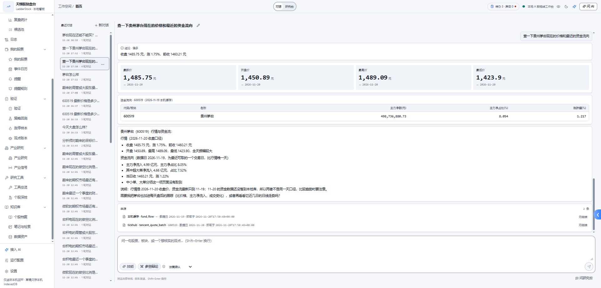

<h1 align="center">LadderStock · 天梯股复盘台</h1>

<p align="center">
  <b>面向 A 股短线交易者与个人研究者的本地化复盘、研究与跟踪工作台</b><br>
  盯盘 → 复盘 → 明日验证 → 交易日志 → 个股研究，闭环跑在本机
</p>

<p align="center">
  程序算数 · AI 解读 · 状态可恢复 · 数据可追溯 · 多源可降级
</p>

<p align="center">
  复盘辅助与交易日志，不是投资建议 · 不接实盘 · 不托管账户
</p>

<p align="center">
  
</p>

---

LadderStock 是 QuotaFuse 产品线里的**本地复盘 + 个股研究工作台**：情绪温度、晋级率、连板天梯、梯队断层这些指标由确定性代码直出，AI 只负责把数字串成叙事；个股研究走固定的六段管线（公司画像 → 财务 → 盈利预期 → 估值 → 风险 → 报告合成），AI 同样只写叙述，数字留在 `facts` 里；交易日志、持仓、自选只存本机 SQLite，不进 MCP、不进 AI 上下文。

它不做行情采集，也不做多角色辩论。行情与资金由 `TickHub-CN` 提供，财报三表与口径由 `FinanceCoffer` 提供，资讯由 `QuotaFuse Wire` 提供，多角色分析与辩论交给 `StockSenate`；LadderStock 只负责交易者的日常复盘、纪律执行与单票研究，并用统一 `LadderEnvelope` 与生态对齐。

- **程序算数、AI 解读**：指标全部确定性计算，AI 失败只降级叙事，不污染数字。
- **状态可恢复**：Zustand persist → IndexedDB，刷新不丢复盘草稿与未提交验证条件。
- **数据可增量**：DuckDB + Parquet 按日期分区，水位线增量同步，盘中快照与历史复盘冷热分离。
- **数据源可兜底**：Provider Registry 主源 → 备源 → 降级，单源故障不中断复盘，UI 标注当前数据源。
- **AI 可降级**：五段式复盘状态机，逐段持久化；结构化输出 → fallback 链 → 纯文本降级，错误四分类可行动。
- **本地优先**：默认只监听回环地址，零强制云端账户，隐私数据不出本机。

> **边界**：不输出交易信号或买卖建议；不接实盘自动交易；不重复实现行情与资讯采集；不把程序计算交给 AI。

---

## 与 QuotaFuse 生态的分工

| 能力 | LadderStock | TickHub-CN（StockData） | QuotaFuse Wire | StockSenate（Council） |
|---|---|---|---|---|
| 盘中盯盘、复盘、明日验证对账 | ✅ | ❌ | ❌ | ❌ |
| 交易日志与纪律复查 | ✅ | ❌ | ❌ | ❌ |
| 行情、财报、公告、资金 | 消费（可本地兜底） | ✅ | ❌ | 消费 |
| 新闻、政策、产业链资讯 | 消费（可选） | ❌ | ✅ | 消费 |
| 多角色分析、辩论、回测 | ❌ | ❌ | ❌ | ✅ |
| MCP 工具 | 复盘 / 情绪 / 验证类 | 数据类 | 资讯类 | 分析类 |
| 隐私数据本地存储 | ✅ 仅本机 | ❌ | ❌ | ❌ |

数据、资讯、决策、复盘四层通过统一 envelope 与 MCP 工具解耦，互不重复建设。数据侧另有 `FinanceCoffer`（财报三表与口径）与 `ProxyFleet`（出站代理池）：前者供财务数据，后者供各 peer 的出站请求，两者都不参与复盘层计算。

### 边界是可执行的，不只是写在文档里

LadderStock 是**第四层：复盘与纪律执行层**，只消费前三层。这条边界由代码和 CI 强制，不是口头约定：

| 闸门 | 实现 | 拦什么 |
|---|---|---|
| 归属目录 | `core/boundary.py: DATASET_CATALOG` | 未登记 peer+tool 的数据集不许同步（= 不许自建采集） |
| 唯一入口 | `data/adapters/{tickhub,wire,senate}.py` | 三种信封只能经对应 adapter 进入，且校验数据集归属 |
| 配置契约 | `config/sources.yaml` / `sync.yaml` + `audit_sources()` | 只写 peer+tool，不写供应商；备源跨 peer 直接违规 |
| 静态禁令 | `scan_no_collection()` | 源码出现 `akshare`/`tushare` 等采集库或 `push2.eastmoney.com` 等行情站点即失败 |
| AI 只写叙述 | `assert_narrative_only()` / `merge_narrative()` | AI 输出与指标键重名、或出现白名单外的键即报错，数字不可能被覆盖 |

降级规则只有一条：**peer 不可用 → 同 peer 备工具 → 本地缓存回放**（`freshness=cached`、`source_status=degraded`），**永远没有"我们自己抓"这个分支**。

```bash
python -X utf8 -m pytest tests/contract/test_ecosystem_boundary.py -q   # 29 条边界契约
ldst doctor --output json     # boundary:no_collection / boundary:datasets
```

## 能力总览：六个子模块拼出什么

LadderStock 本身不算数、不采集、不做多角色辩论；它的所有能力都是「本地工作台 + 子模块」的组合。子模块各自独立运行、各自可单独使用，缺哪个就只降级哪一块：

| 子模块 | 默认端口 | 它提供什么 | 缺了以后 LadderStock 的表现 |
|---|---|---|---|
| **TickHub-CN** | 8000 | A 股数据枢纽：行情 K 线、财报、资金面、公告、研报、宏观、指数、期货、期权、可转债，14 层 / 151 个 MCP 工具 | 行情类数据回放本地缓存，标注 `freshness=cached`，不静默补 0 |
| **TickHub-US** | 8002 | 美/港股数据引擎：行情、基本面、期权与资金流、空头数据、SEC  filings 与 13F、全球利率、能源，41 个 MCP 工具 / 20 个信源 | 跨市场页面显示离线，A 股功能不受影响 |
| **QuotaFuse Wire** | 8790 | 全球产业链资讯：12 大赛道、100+ 信源、每日中文「今日要点」、原文可下钻 | 资讯雷达与产业信号降级为本地缓存，标注来源缺失 |
| **StockSenate** | 8765 (MCP) / 8786 (WebUI) | 多角色投研合议：7 分析师 → 多空辩论 → 研究经理 → 交易员 → 三档风控 → 投决 → 质量门，附回测推演 | 单票研究只跑到本地六段，辩论环节显示「未接线」 |
| **FinanceCoffer** | — | 金融数仓（ODS/DWD/DWS/向量四层）：财报三表、事件、语义检索，带 `quality_status` 与出处 | 财务段落改用 TickHub-CN 的财报工具，口径标注切换 |
| **ProxyFleet** | 8789 (网关) / 8788 (控制台) | 自建代理池：自动采集、体检、按请求换 IP；下游把商业池地址换成 `127.0.0.1` 即可 | 采集侧走直连或降速，不影响已落库数据的读取 |

对应到「你想干的事」，是这样一条一条落地：

| 你要干的事 | 在哪个页面做 | 主要依赖 |
|---|---|---|
| 开盘前 5 分钟判断今天有没有事 | 首页 `/` | TickHub-CN（情绪、连板、持仓异动） |
| 盘中识别阈值信号 | 盘中信号 `/watch`、竞价与盘中 `/intraday` | TickHub-CN 实时行情 |
| 收盘后 15–30 分钟核对五段指标并写判断 | 每日复盘 `/review` | TickHub-CN + 本地 DuckDB |
| 写明日条件、次日对账 | 验证 `/validate` | TickHub-CN 次日日线 |
| 记录每笔交易与理由、看纪律 | 交易日志 `/journal` | 纯本地 SQLite，不依赖任何 peer |
| 回答「之前那些判断后来对了吗」 | 观点账本 `/ledger` | 本地落账 + 日线回访判定 |
| 把赚亏原因摆到一页 | 复盘统计 `/analytics` | 本地日志 + 行情 |
| 一屏看完行业冷热与信号命中 | 产业研究 `/industry`、产业信号 `/signals` | TickHub-CN 行业数据 + Wire 资讯 |
| 单票事实、趋势、风险、估值四件套 | 个股深挖 `/research/:code` | TickHub-CN + FinanceCoffer |
| 逐段读六段报告并核来源 | 研究报告 `/research/:code/report` | 同上，引用逐条可回溯 |
| 多角色辩论与投决 | 跳 StockSenate WebUI | StockSenate + TickHub + Wire |
| 扫当日增量资讯 | 资讯雷达 `/news` | Wire |
| 查个股档案、翻自己的笔记 | 知识库 `/knowledge`、笔记与检索 `/knowledge/notes` | 本地 SQLite + 向量检索 |
| 看数据覆盖缺口、受控补采 | 数据资产 `/data-assets`、运行配置 `/config` | TickHub-CN / FinanceCoffer 覆盖面 |
| 定时提醒、规则触发 | 提醒 `/inbox`、提醒规则 `/alert` | 本机调度 + 渠道（邮件 / Webhook） |
| 直接问一句话要结论 | 首页对话面板 | 任意 OpenAI 兼容模型，失败降级为纯事实卡 |

## 个股研究（R1）

单票研究是固定六段的顺序管线，每段产物落盘、可断点续跑：

```text
公司画像 → 财务 → 盈利预期 → 估值 → 风险 → 报告合成
```

- 本包只做**编排与落盘**，不联网检索（联网检索属 R4，需人类批准后才发起）。
- AI 只写叙述，数字由程序计算并留在 `facts` 里，报告段只消费前五段的产物。
- 引用可回溯：每条事实带来源与 `as_of`，数据源缺位时显式标注为兜底，不与自填引用混算。
- 失败可续：某段失败只影响该段，重跑从断点继续，不重算已落盘的前序段。

页面契约与溯源口径见 [docs/specs/SPEC-RESEARCH-PAGES.md](docs/specs/SPEC-RESEARCH-PAGES.md)、[docs/specs/SPEC-RESEARCH-PROVENANCE.md](docs/specs/SPEC-RESEARCH-PROVENANCE.md)。

## 页面地图（11 组 25 屏）

侧栏按「你什么时候用它」分组，不是按技术模块分组。状态标记：

- **稳定**：有 UI 规格（`docs/UI-SPEC.md`）与前后端契约测试，空态 / 错误态 / 降级态都有明确下一步动作。
- **可用**：已交付并通过本机实机验证，UI 规格尚未入册，交互细节可能调整。
- **依赖在线**：页面本身稳定，但其中某一块必须 peer 在线才有数据，离线时显式降级。

| 分组 | 页面 | 路由 | 能做什么 | 状态 |
|---|---|---|---|---|
| 首页 | 首页 | `/` | 开盘前 5 分钟判断「今天有没有要做的事」：持仓异动、待验证条件、今日事件；对话面板可直接问一句话 | 稳定 |
| 市场 | 情绪温度 / 连板梯队 / 题材轮动 | `/market?tab=sentiment\|ladder\|theme` | 把当日市场拆成三段事实：赚钱效应、晋级率与断层、题材强弱 | 稳定 |
| 市场 | 资讯雷达 | `/news` | 开盘前后 10 分钟扫完当日增量资讯，标注来源与时间 | 稳定 |
| 盯盘 | 盘中信号 | `/watch` | 盘中按阈值规则识别信号，给触发依据而不是给买卖点 | 稳定 |
| 盯盘 | 竞价与盘中 | `/intraday` | 当日 6 个时点快照，看竞价、开盘、午盘、尾盘的结构变化 | 稳定 |
| 复盘 | 每日复盘 | `/review` | 收盘后 15–30 分钟核对五段程序指标并写下判断 | 稳定 |
| 复盘 | AI 复盘 | `/review/ai` | 看模型当天写了什么、哪段没写出来、把没写出来的单独重跑 | 稳定 |
| 复盘 | AI 周报 | `/weekly` | 一周一次，把五段结论回看成趋势 | 稳定 |
| 复盘 | 复盘统计 | `/analytics` | 组合指标卡、净值曲线、基准对比、交易归因、行为统计、错题本；90/180/365/730 天窗口，CSV 分节导出 + XLSX 一簿四表 | 可用 |
| 复盘 | 候选池 | `/pool` | 把复盘产出的候选按分项拆开核对 | 稳定 |
| 日志 | 交易日志 | `/journal` | 记录每笔交易与理由，定期看纪律；只存本机 SQLite | 稳定 |
| 我的股票 | 我的股票 | `/my-stocks` | 自选七列 + 持仓成本、市值、收益率，两个标签页 | 稳定 |
| 我的股票 | 事件日历 | `/calendar` | 月视图定位到某一天，读当日事件（财报、解禁、分红等） | 稳定 |
| 我的股票 | 提醒 | `/inbox` | 读本机定时任务落下的事实行，把看过的标成已读 | 稳定 |
| 我的股票 | 提醒规则 | `/alert` | 七类规则的清单与启停；渠道管理（SMTP 密码只存环境变量名）；手动跑一轮；触发历史 | 可用 |
| 验证 | 验证 | `/validate` | 收盘后写明日条件，次日收盘后对账 | 稳定 |
| 验证 | 策略回测 | `/backtest` | 只读运行卡：参数 / 结果 / 证据三区，不在这里调参 | 稳定 |
| 验证 | 涨停样本 | `/limit-up` | 核对当日涨停池与连板序列 | 稳定 |
| 验证 | 观点账本 | `/ledger` | 「之前那些判断后来对了吗」：方向 + 基准价 + 翻转条件 + 期限，到期由回访拉日线判定，未到期的不算进命中率 | 可用 |
| 产业研究 | 产业研究 | `/industry` | 一屏看完申万一级行业的热力与缺口，下钻到单行业五维事实与成分股 | 稳定 |
| 产业研究 | 产业信号 | `/signals` | 按规则命中的清单下钻到证据 | 稳定 |
| 研究工具 | 工具总览 | `/skills` | 8 个 skill 的列表页，含输入输出与调用示例 | 稳定 |
| 研究工具 | 个股深挖 | `/research` → `/research/:code` | 一只票的事实、趋势、风险、估值四件套，再进研究报告逐段核来源 | 依赖在线 |
| 知识库 | 个股档案 | `/knowledge` → `/knowledge/:market/:symbol` | 平台平时自动攒下来的个股档案，按代码检索 | 可用 |
| 知识库 | 笔记与检索 | `/knowledge/notes` | 自己的笔记与全文 / 语义检索 | 可用 |
| 知识库 | 数据资产 | `/data-assets` | 数据覆盖看板：哪些域有数、哪些缺、缺口在哪一天；财报 / 业绩预告 / 分红 / 回购 / 诉讼 / 并购等文档索引 | 可用 |
| 知识库 | 运行配置 | `/config` | 同步数据集开关、补采池、调度任务启停、进度状态 | 可用 |
| 设置 | 设置 | `/settings` | 本机控制面状态、端口、peer 探测、接入 AI（模型与 Key） | 稳定 |

> 侧栏还有「接入 AI」一处入口（模型与 Key 的配置面），与设置页共用同一份配置。

## 成熟度：现在到哪一步

| 维度 | 现状 |
|---|---|
| 页面与契约 | 21 屏有 UI 规格 + 契约测试；新增 6 屏（复盘统计 / 提醒规则 / 观点账本 / 数据资产 / 运行配置 / 笔记检索）已交付，规格待入册 |
| 计算可信度 | 指标全部确定性计算，AI 只写叙述；`assert_narrative_only()` 保证 AI 不能覆盖数字 |
| 数据可信度 | 每条事实带来源与 `as_of`；缺数显示「—」不补 0；`freshness` / `source_status` 上屏 |
| 研究可信度 | 六段报告逐段落盘、断点续跑；引用可分「自填」与「兜底」两类统计，兜底不混算成模型能力 |
| 部署形态 | 单机裸机：Python venv + 本机调度，端口固定 5950 / 5951 / 5952；一键安装包仍在做 |
| 外部可用性 | 当前 **Alpha**：自己人可跑，外部机构还不能自助部署；对外测试建议先给报告样例与只读链接，不给安装包 |

## 架构

```text
┌─────────────────────────────────────────────────────┐
│ 调用层：CLI(ldst) │ 本地 Web 看板 │ MCP Server │ Council │
└─────────────────────────────────────────────────────┘
                          │
┌─────────────────────────────────────────────────────┐
│ LadderStock 核心                                     │
│ 盘中盯盘 │ 收盘复盘 │ 情绪计算 │ 明日验证对账 │ 交易日志 │
│ AI 编排状态机 │ 错误分类反馈 │ 降级提示 │ 断点恢复      │
└─────────────────────────────────────────────────────┘
                          │
┌─────────────────────────────────────────────────────┐
│ 数据层                                               │
│ Provider Registry（主源 → 备源 → 降级）               │
│ DuckDB + Parquet（日线 / 指标 / 事件，水位线增量）    │
│ SQLite（交易日志 / 持仓 / 配置，本地隐私）            │
│ 可选：TickHub-CN / Wire / 本地缓存                    │
└─────────────────────────────────────────────────────┘
                          │
┌─────────────────────────────────────────────────────┐
│ 前端状态层                                           │
│ Zustand persist → IndexedDB（分片、版本迁移、恢复语义）│
└─────────────────────────────────────────────────────┘
```

前端形态与生态内看板保持一致：**React + Vite 本地浏览器 UI**（由 `ldst run` 在本机托管），不引入 Electron；Tauri 2.0 仅作为后续阶段的可选打包壳。

## 安装

需要 **Python ≥ 3.11**（与 TickHub-CN / StockSenate 保持一致），Node ≥ 22 仅用于前端构建。

```bash
pip install ladderstock           # 核心
pip install "ladderstock[all]"    # 全功能（mcp / web / pdf）
pip install -e ".[dev]"           # 开发
```

可选 extras：`mcp`（MCP Server）、`web`（本地看板）、`pdf`（PDF 导出与中文字体）、`all`。

开发环境使用 Python 3.12 创建的虚拟环境 `.venv`。

## 快速开始

```bash
ldst config migrate        # 首次启动：只读迁移旧配置与旧数据目录
ldst sync                  # 增量同步（水位线之后的数据）
ldst review --date 2026-10-22
ldst validate --date 2026-10-22
ldst run                   # 打开本地工作台 http://127.0.0.1:5950
ldst watchdog              # 看门狗：探活 + 顶栏状态灯 + 离线壳页（5952）
```

结构化结果走 stdout，日志走 stderr；`--output json|table|csv` 三档可选。

端口固定 `5950`（看板）/ `5951`（MCP http）/ `5952`（看门狗），默认只监听 `127.0.0.1`；**端口被占用时直接报错并提示 `--port`，不静默换端口**——IndexedDB 按 origin 隔离，端口漂移会丢前端状态。

### 本机子模块（peer）

设置页的「安装 / 启动 / 停止」按钮只在后端探测到 peer 目录时出现。仓库默认按**同级目录**探测：

```text
<parent>/
├── LadderStock/
├── TickHub-CN/
├── TickHub-US/
├── quotafuse-wire/
└── StockSenate/
```

仓库放在别处时，用固定环境变量覆盖（键是白名单，不接受任意字符串）：

| peer | 环境变量 |
|---|---|
| TickHub-CN | `LDST_PEER_DIR_TICKHUB` |
| TickHub-US | `LDST_PEER_DIR_TICKHUB_US` |
| QuotaFuse Wire | `LDST_PEER_DIR_WIRE` |
| StockSenate | `LDST_PEER_DIR_SENATE` |

目录不存在时设置页只读展示该 peer，并给出对应变量名，不会出现「装了半天没按钮」。

## 上手路径（第一周怎么用）

**Day 1：跑起来**

```bash
pip install -e ".[all]"
ldst config migrate      # 首次启动：只读迁移旧配置与旧数据目录
ldst sync                # 增量同步（水位线之后的数据）
ldst run                 # → http://127.0.0.1:5950
```

首页若能看到「今天有没有要做的事」的事实行，说明 TickHub-CN 已通；若整屏是降级提示，先去设置页看 peer 探测结果，按提示设 `LDST_PEER_DIR_*`。

**每天收盘后 20 分钟**

1. `/review` 核对五段程序指标并写下判断；草稿自动进 IndexedDB，刷新不丢。
2. `/validate` 写次日条件——必须可判定（价格、量、事件），不写「感觉会涨」。
3. 次日收盘再进 `/validate` 对账，对错都留档，这是后面 `/analytics` 的原料。
4. 每笔交易进 `/journal`，理由必填；没有理由的交易不记，等于没做。

**每周日 10 分钟**

`/weekly` 看五段结论回看成趋势；`/analytics` 看归因与错题本；`/ledger` 看还有多少观点没到期、已判定的命中率。

**要做一只票**

`/research` 输入 6 位代码 → 六段跑完 → 进 `/research/:code/report` 逐段读。重点核引用卡：点开每条来源看原文与 `as_of`；标注为「兜底」的条目说明这一段没有可回溯原文，只能当线索，不能当模型结论。

**数据不够用**

`/data-assets` 看缺口表（哪个域、缺哪天）→ `/config` 选补采池做受控补采 → 回对应页面重取。补采是有边界的，不会全市场乱抓。

## 命令行

命令基线 **31 条，已全部定为 P0**（19 条文档明文 + 12 条补齐缺口），完整参数与退出码见 [docs/CLI.md](docs/CLI.md)，分层与数据流见 [docs/ARCHITECTURE.md](docs/ARCHITECTURE.md)，配置与旧版迁移见 [docs/CONFIG.md](docs/CONFIG.md)。

```bash
ldst run [--port 5950]            # 启动本地工作台
ldst watchdog                     # 独立看门狗（5952）：状态灯 / 离线壳页 / 安全重启
ldst review --date 2026-10-22     # 重新生成指定日期复盘
ldst review show --date 2026-10-22
ldst validate --date 2026-10-22   # 明日验证条件与对账结果
ldst validate reconcile --date 2026-10-22
ldst sentiment show --date 2026-10-22
ldst ladder show --date 2026-10-22
ldst sync [--dataset daily_k] [--full]
ldst sync status                  # 水位线与最近同步状态
ldst sources list|validate|health
ldst watch start|status|stop      # 盘中盯盘
ldst notify test                  # 盘前提醒链路冒烟
ldst journal add|list|stats       # 交易日志（仅本地 SQLite）
ldst export --format pdf|md       # PDF 失败自动降级 Markdown
ldst state inspect|reset
ldst ai status|retry|chain test
ldst mcp stdio | ldst mcp http --port 5951 | ldst mcp tools list
ldst config validate | ldst config migrate
ldst schedule list|run
ldst doctor                       # 依赖、端口、缓存目录、数据源体检
```

## MCP 工具

沿用 7 个只读工具 + 1 个发起研究工具，并新增：

| 工具 | 说明 |
|---|---|
| `ladder_get_review(date)` | 某日复盘结构化结果 |
| `ladder_get_validation(date)` | 明日验证条件与对账结果 |
| `ladder_get_sentiment(date)` | 情绪温度、晋级率、梯队断层 |
| `industry_snapshot(industry)` | 申万一级行业五维画像：景气 / 资金 / 估值 / 动量 / 拥挤度（R5） |

输出统一 `LadderEnvelope`；隐私数据（交易日志、持仓、自选）永不出现在 MCP 输出与 AI 上下文中。

## 配置

| 文件 | 作用 |
|---|---|
| `config/sources.yaml` | 数据源与主备顺序、超时、重试、冷却、权重 |
| `config/sync.yaml` | 数据集与增量模式（append / replace）、冷热分离 |
| `config/ai.yaml` | 默认模型、fallback 链、分段 prompt 与输出 schema |
| `config/industry.yaml` | 申万一级行业清单与窗口参数（R5，口径见 `docs/specs/SPEC-INDUSTRY-METRICS.md`） |
| `config/state.yaml` | 前端持久化分片、TTL、schema 版本 |

校验：`ldst config validate`；JSON Schema 位于 `config/schema/`。

## 里程碑

| 里程碑 | 内容 | 验收 |
|---|---|---|
| M1 状态连续性与体验修复 | IndexedDB 持久化；PDF 中文字体；AI 错误分类 | 刷新可恢复；PDF 中文正常；错误可行动 |
| M2 增量数据层与源韧性 | DuckDB / Parquet 增量；Provider Registry；冷热分离 | 同步提速；单源故障不中断；历史可查 |
| M3 AI 编排与生态集成 | 状态机；fallback 链；MCP 新工具；Envelope 对齐 | AI 可降级可恢复；MCP 可调用；字段对齐 |
| M4 验证门禁与产品化 | 时间敏感实机清单；跨平台验收；裸机 supervisor / 只读 API | 关键场景实机通过；一键部署；本机监听 |

## 目录结构

```text
ladderstock/
├── config/            # sources / sync / ai / state + schema
├── prompts/           # 五段式复盘 prompt
├── docs/              # 架构、配置、CLI、包名、MCP、迁移、发布清单
├── src/ladderstock/   # core / data / ai / research / review / journal / industry / knowledge / mcp / cli / web / config
├── frontend/          # stores / persist（IndexedDB）
├── compatibility/     # 旧启动方式委托新版
├── data/              # 运行数据（gitignore）：market.duckdb / journal.sqlite / archive/
├── tests/             # unit / integration / contract / state / compat
└── scripts/           # 源校验、数据迁移、发布冒烟
```

## 兼容与迁移

| 项 | 新值 | 兼容策略 |
|---|---|---|
| 仓库 | LadderStock | README 标注“已升级为 LadderStock”，旧仓库名保留过渡 |
| PyPI / 导入包 | `ladderstock` | 单包，不发布 quotafuse 前缀包 |
| CLI | `ldst` | 注册长别名 `ladderstock` |
| 启动方式 | `ldst run` | 旧启动脚本委托新版并打印提示 |
| 端口 | 5950（看板）/ 5951（MCP http）/ 5952（看门狗） | 被占用直接报错不换端口；旧 5940 / 8770 仅打印迁移提示 |
| 配置与环境变量 | platformdirs 用户数据目录（Win `%LOCALAPPDATA%\QuotaFuse\LadderStock`、mac `~/Library/Application Support/LadderStock`、Linux `$XDG_DATA_HOME/LadderStock`）、`LDST_*` | 首跑从随包模板 seed 缺失配置（不覆盖已有）；首次启动只读迁移旧目录，兼容读取旧前缀 |

## 开发

```bash
python -m venv .venv && . .venv/Scripts/activate   # Windows；Python 3.12
pip install -e ".[dev]"
python -X utf8 -m pytest -q                        # Windows 控制台建议 -X utf8
ruff check .
mypy src
ldst doctor                                        # 23 项体检：解释器 / 依赖 / 端口 / 配置 / 边界
```

CI 实际执行的 job、与 workflow 逐字对齐的本地命令（含 Windows / POSIX 的 venv 路径差异）以及 required checks 现状，见 [docs/CI.md](docs/CI.md)。

测试不依赖网络与 API Key：全部走本地 fixture 与 offline provider。当前基线 **614 passed**（另有 4 个旧版兼容性用例由 xfail 转 XPASS）；31 条命令已全部注册可执行，施工期占位（退出码 `70`）已随 `config migrate` 落地而退役（见 `docs/CLI.md` §F、`docs/CONFIG.md`）。

## License

Apache License 2.0。
