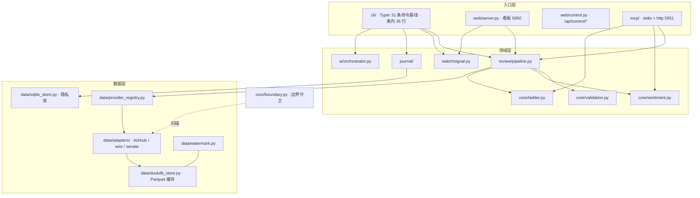

# 架构说明（ARCHITECTURE）

一句话：LadderStock 是**本地优先**的 A 股短线复盘工作台——一个 Python 单体进程对外提供
CLI、本机 HTTP/看板与 MCP 三种入口，数据只从生态 peer 取、只在本机落盘，不采集、不上云。

## 1. 分层



设计原则：

- **本地优先**：没有网络也能跑（离线 provider + 缓存重放）；所有配置、缓存、隐私库都在本机。
- **生态边界**：本项目**不采集**。数据只能来自 provider registry 登记的生态 peer；
  单源故障按「主源 → 同层备源 → 缓存重放」降级，缺数据就报退出码 8，绝不自己动手抓。
- **端口**：看板 `5950`、MCP http `5951`，只监听回环；端口被占用直接失败（退出码 3），
  不静默换端口（IndexedDB 按 origin 隔离）。
- **控制面**：`web/control.py` 在读写面上单开一层 `/api/control/*`，让看板能看见、安装、
  启停、配置四个 peer（TickHub-CN / TickHub-US / Wire / StockSenate）。与数据面严格分层：只接受回环
  来源（非回环 403），写方法另需正向证据（`Origin` 同源或 `X-LDST-Client: 1`），
  `LDST_CONTROL_ENABLED=0` 时整族 404 而数据面只读接口零影响；命令一律
  `subprocess.run([...], shell=False)` 走 `core/boundary.py` 白名单，不建 shell 字符串；只动 peer 自己的
  `.venv` 与**其真正加载的那个 dotenv**（TickHub-CN / US / Senate 是 `.env`，Wire 是 `.env.local`，
  由 `PeerControl.env_filename` 声明），不写 PATH、不改系统代理、不杀端口占用者；密钥 GET
  只回打码预览、日志脱敏；任务失败最多重试 1 次即 `failed` 并附最后 20 行输出，不静默降级。

## 2. 两种持久化，各管一摊

| 存储 | 位置 | 存什么 | 谁不能读 |
|---|---|---|---|
| DuckDB + Parquet | `data/market.duckdb`、`data/archive/YYYY/MM/DD/*.parquet` | 行情快照、复盘产物、同步缓存 | — |
| SQLite（WAL） | `data/journal.sqlite` | 交易日志、持仓、自选 | `LadderEnvelope`、MCP、AI prompt |

隐私边界是硬约束：`journal/` 与 `sqlite_store` 只读写本地文件，没有任何网络分支；
序列化进 MCP/AI 的对象里不含这三个表。`scripts/check_privacy.py`（5 组扫描）与
`doctor` 的 `boundary:*` 体检共同把关。

前端状态（Zustand + IndexedDB）走 `config/state.yaml` 声明的分片，见 `docs/STATE_PERSISTENCE.md`；
Python 侧**从不读 IndexedDB**，只迁移配置清单。

## 3. 一次复盘请求的路径

```
ldst review --date D
  → review/pipeline.py  读 DuckDB 缓存 + sources 适配器（经 provider_registry 解析）
  → core/sentiment.py   程序直出情绪/晋级率/断层（不经过 AI）
  → core/ladder.py      梯队分层
  → ai/orchestrator.py  按 ai.yaml 顺序调模型；失败按 error_taxonomy 分类，
                        fallback.py 降级、checkpoint.py 断点续跑
  → 结构化结果写 stdout（table/json/csv）与 data/review/<date>.json
```

AI 只负责**叙述**，数值一律程序直出；AI 全挂时以退出码 9 交付已完成的部分，
成功段落保留（`ai retry` 只补失败段落）。

### 一次个股研究的路径（六段 + 受控工具）

```
ldst research <code> [--date --only --retry-failed --force]
  → research/pipeline.py  company→financial→forecast→valuation→risk→report，
                          每段结果过 core/boundary 闸门后落 data/research/<code>/<date>/<stage>.json|.md
  → research/stages.py    提示词 + ALLOWED_TOOLS（每段能用哪几个工具，代码内常量）
  → research/ladder.py    三级阶梯：structured → parsed（文本抢救）→ text（degraded）
  → ai/tools.py           受控工具执行 + 审计（data/research/<code>/<date>/tool_calls.jsonl）
```

工具通道是**可选能力**：客户端没有 `complete_with_tools()`（五段复盘、既有集成）时，消息与调用序列
与不带工具的版本逐字相同。模型调用本段白名单之外的工具 → 该段第 1 次即判 `failed`、不重试、不换模型，
其余段不受影响（退出码 9）；参数或路径被拒 → 拒因回喂给模型，段继续跑。
工具只能读写本次研究目录内的产物，canonical `<stage>.json|.md` 由程序落盘，模型写的是
`<stage>__<name>` 草稿。

## 4. 入口与输出约定

- **stdout 只放结构化结果**，日志一律 stderr；`mcp stdio` 的 stdout 只跑协议报文。
- **退出码**：0 成功 / 2 参数 / 3 配置 / 4 数据源不可用 / 6 对象不存在 / 8 部分失败 / 9 AI 降级。
  （历史上的 70「施工期占位」已随 `config migrate` 落地而退役。）
- **兼容入口**：`scripts/start`、`scripts/start.cmd`、`compatibility/start.py` 一律委托 `ldst run`，
  细节见 `docs/CONFIG.md` §6。

## 5. 可观测性

| 手段 | 说明 |
|---|---|
| `ldst doctor` | 23 项体检：解释器、依赖、端口、目录可写、配置、边界、数据源链路、版本；`--output json` 给机器。配置项数 = `cli/paths.py:CONFIG_FILES` 的长度，新增一份配置就 +1（新增 `industry.yaml` 时 +1） |
| 结构化输出 | 所有命令统一 `--output json|table|csv`，字段稳定可供契约测试断言 |
| `data/research/<code>/<date>/tool_calls.jsonl` | 受控工具审计：一次调用一行（段、工具、入参摘要、结果摘要、耗时、被拒与拒因），越权尝试同样留痕 |
| `data/state/migration.json` | 迁移审计：版本、步骤、备份路径 |
| `data/control/peer_state.json` | 控制面只记录**由本进程启动**的 peer PID 与启动时间；「停止」只对这些 PID 生效，绝不误杀他人进程 |
| `/api/control/jobs/{id}` | 安装/启停/AI 生成任务的统一任务视图（`log_tail` 最多 20 行、线程池任务不随页面关闭丢失） |
| 静默原则 | 日志与报错不打印凭据原文；`scripts/check_privacy.py` 的 `credential-printing` 组扫描 |

## 6. 非目标

- 不做常驻行情订阅（盯盘是离线单轮扫描，依赖 peer 落盘节奏）；
- 不做多用户/远端部署（无账号体系、无服务端数据库）；
- 不内置任何采集库或行情站点直连（`akshare` / `tushare` / `pytdx` 等一律禁止）。
