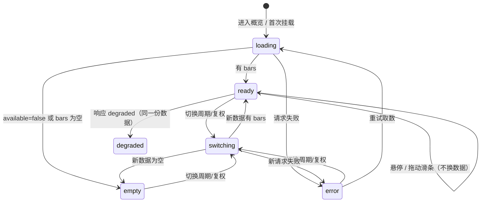

# SPEC-KLINE-MODULE 个股深挖 · K 线主图模块（前端）

- 版本：v1.0（2026-11-05 首版，QUOT-412）
- 日期：2026-11-05
- 归属：UI/UX（视觉与交互）；实现归属：前端架构
- 状态：待评审（QUOT-411 对齐用；QUOT-413 验收用）
- 实现基线（评审时的事实来源）：
  - 前端：`frontend/src/charts/CandlestickChart.tsx`、`charts/candles.ts`、`charts/ma.ts`、
    `screens/research/OverviewTab.tsx`（PR #94，head `agent/agent/19808881dc64`）
  - 后端：`GET /api/research/{code}/kline`（PR #95，head `agent/agent/66bab01aef36`；
    契约见 `docs/specs/SPEC-RESEARCH-PAGES.md` §2.4 / DEC-055）
- 视觉外壳：`docs/UI-SPEC.md` v1.13 的 §3.16.1（K 线模块）、§6.1（组件登记）、
  §7.1（颜色）、§8（数字文案）、§9（可访问性）、§11.16（逐屏验收）
- token 真源：`frontend/tokens.json`（`chart.*`；PR #94 新增 `chart.ma-1..4`）
- 本文档**不写前端代码、不改 `frontend/src`、不改 tokens 值**。所有颜色只引用 token
  的 CSS 变量或语义类，不新增色字面量。

## 0. 范围与非目标

**范围**：`/research/:code` 概览 tab 内「走势」卡（`SectionCard`）的 K 线模块——周期与复权
切换、涨跌与均线图例、十字光标读数、蜡烛主图、成交量副图、底部日期区间滑条、模块四态、
深浅双主题、token 引用与验收口径。六段研究 tab 不受影响。

**非目标**：指标叠加（MACD/KDJ/BOLL）、画线工具、逐笔/分时、多标的对比、复权计算
（由上游完成）、数据导出、K 线全屏页、移动端专用手势。也不在本文档范围内修复
`frontend/src`；代码改动由 QUOT-411 / 后续修复单执行。

**信息目标**（用户 3 秒内应读出）：最近一段趋势方向、当前窗口覆盖的日期区间、四条均线
的相对排列、涨跌与量能的配合。模块只呈现上游原值，不预测、不评分、不合成行情。

## 1. 布局与尺寸

### 1.1 结构示意（文字版）

```
SectionCard「走势」（C-10；radius、1px border-border、shadow-card）
├─ CardHeader（56，px-4 py-2，border-b）
│  ├─ 标题：走势                              右侧：[K线] / [部分数据]
│  └─ 副标题：K 线 · 成交量 · MA5/10/20/60（上游聚合，前端不合成行情）
└─ Body（p-4）
   ├─ 工具栏（24）  [日|周|月]  [前复权|后复权|不复权]
   │                右：N 根 · 起 → 止 · 日/周/月线 · 前/后/不复权
   ├─ 图例/MA（18） [■阳线] [■阴线]
   │                右：MA5 …  MA10 …  MA20 …  MA60 …（值随光标）
   ├─ 读数（26）    ▲日期  开 …  高 …  低 …  收 …  量（手）…     右：[最新]
   ├─ 主图（280）   蜡烛（阳/阴双色）+ MA×4；右 y 轴 48；仅水平网格
   ├─ 副图（96）    量柱（随阳/阴同色）；底部日期轴；右 y 轴 48
   ├─ 滑条行（32）  轨道可视高 12 居中；双手柄视觉 8×24、命中 32×32
   └─（可选增强）<details> 数据表 · 日期/开/高/低/收/量 </details>
```

### 1.2 尺寸表

| 元素 | 规格 | 依据 |
| --- | --- | --- |
| 卡片头 | `min-h-topbar` 56，`px-4 py-2`，`border-b border-border` | C-10 `ui/Card.tsx:38` |
| 卡片内距 | `p-4` 16 | C-10 `CardBody` |
| 工具栏行 | 高 24（`Segmented size="sm"` 的 `h-6`） | C-07 `ui/Segmented.tsx:83` |
| 工具栏 → 图例 | 12（`gap-3`） | 间距刻度 |
| 图例/MA 行 | 18（`text-caption` 12 × 行高 1.5） | §7.2 |
| 图例 → 读数 | 8（`gap-2`） | 间距刻度 |
| 读数行 | 26（12 × 1.5 + `pb-2` 8） | §7.2 |
| 读数 → 主图 | 8（`gap-2`） | 间距刻度 |
| 主图 | 固定 280 | 本文 §5.1 |
| 主图 → 副图 | 4（`mt-1`） | 间距刻度 |
| 副图 | 固定 96 | 本文 §5.1 |
| 副图 → 滑条 | 8（`mt-2`） | 间距刻度 |
| 滑条行 | 32（轨道 12 居中，手柄命中区 32） | 本文 §6.1、§7.3 控件 32 |
| 模块总高（正常态） | ≈ 604（56 + 16 + 24 + 12 + 18 + 8 + 26 + 8 + 280 + 4 + 96 + 8 + 32 + 16） | 未计 1px 边框 |
| 折叠数据表（增强） | 追加 summary 行 32 | 本文 §11.5 |

主图与副图高度固定，不随视口缩放：蜡烛的视觉比例依赖固定高度；1024×768 下页面允许
纵向滚动，但**不允许横向溢出**（UI-SPEC §9）。

### 1.3 可用宽度

| 视口 | 侧栏 | `.page-shell` 内容宽 | 卡内 body / 图表画布宽 | 主图绘图区（减 y 轴 48 + 右 8） |
| --- | --- | --- | --- | --- |
| 1440 | 232 | 1160 | 1128 | ≈ 1072 |
| 1280 | 232 | 1000 | 968 | ≈ 912 |
| 1024 | 56（图标栏） | 920 | 888 | ≈ 832 |

- `.page-shell` 上限 1440、`padding-inline` 24（≥1024），研究页不再套 `contentMax`。
- 120 根满窗时蜡烛实体宽约 5 / 4 / 4px（`round(spacing×0.55)`）；窗口缩到 20 根时
  实体封顶 24px（本文 §5.2），不得出现「宽画布 + 牙签蜡烛」。
- 图表最小绘制宽度 240（沿用 `Chart.tsx`）；上述三档均远大于该值。

### 1.4 视觉层级

1. 主图蜡烛（信息主体）> 读数行（精确值）> 副图量能 > 均线（辅助判断）> 滑条（窗口控制）。
2. 图例与工具栏使用 `text-caption`，不得抢过蜡烛与读数。
3. 卡片左侧状态条（`tone`）仅表达模块状态：正常 `ok`、降级 `warn`、缺数 `neutral`；
   不为装饰而加。

## 2. 周期与复权切换

### 2.1 位置与形式

- **两个 C-07 `Segmented`，`size="sm"`，放在卡片 body 的工具栏行**，顺序固定：
  先周期（日 / 周 / 月），后复权（前复权 / 后复权 / 不复权），组间 `gap-2`（8px）。
- 不放进 `CardHeader.actions`：C-10 的 header actions 只承载该卡的主/次操作（当前是状态
  `Badge`）；两组共 6 个选项会把标题与副标题在 1024 宽挤成两行，也会让「卡级操作」与
  「图表参数」语义混淆。
- 工具栏行用 `justify-between`：左控件、右元信息；`flex-wrap` 兜底，换行时整组换行，
  不拆散组内选项。

### 2.2 标签与默认值

| 组 | 选项与顺序 | 默认 | `aria-label` |
| --- | --- | --- | --- |
| 周期 | 日 / 周 / 月 | 日 | `K线周期` |
| 复权 | 前复权 / 后复权 / 不复权 | 前复权 | `K线复权` |

- 选项值只来自 `KLINE_PERIODS` / `KLINE_ADJUSTS` 与 `KLINE_PERIOD_LABEL` /
  `KLINE_ADJUST_LABEL`（`api/research.ts:508-524`），页面不得另写一套字符串。
- 后端缺省即 `daily` / `qfq`（`limit=120`）。前端始终显式传参，不依赖缺省。

### 2.3 行为

| 场景 | 规则 |
| --- | --- |
| 点击当前已选项 | 不发请求，无视觉变化 |
| 切换 | 立即以新 `period`/`adjust` 发一次请求；旧请求由 `AbortController` 取消 |
| 加载中再切换 | 允许；只采纳最后一次请求的结果（`useAsync` 的 `active` 守卫已满足） |
| 加载中控件 | 保持可用（不禁用），避免用户被锁在慢请求里 |
| 失败后切换 | 用新参数重试；失败态随新请求进入 loading |
| 切换成功 | 滑条窗口重置为默认窗口（本文 §6.4），光标索引清空 |
| URL | 建议 `?period=weekly&adjust=hfq`，`replace` 写入，保留 `?tab=`、`?date=` 等其他参数；非法值忽略并回落默认（**不把非法值发给后端**，后端会 422） |

URL 化的理由：tab 已按 `?tab=research` 记地址（`ResearchDetailScreen.tsx:567-574`），
参数同法记录后，刷新、后退、从六段 tab 返回都能复原用户看的那张图。若本轮不做，
需在验收里明确「切 tab 返回会重置为日/前复权」是已知行为。

### 2.4 元信息串

工具栏右侧一行 `text-caption text-text-muted`，数字用 `.ldst-num`：

```
{count} 根 · {firstDate} → {lastDate} · {日|周|月}线 · {前复权|后复权|不复权}
```

- 示例：`120 根 · 2026-05-10 → 2026-09-06 · 日线 · 前复权`。
- `count` 是**实际收到的 bar 数**，不是请求的 `limit`；空态/加载中不显示该串。
- 日期一律 `YYYY-MM-DD`（UI-SPEC §8）；不得显示后端裸值。
- 周/月线文案为「周线」「月线」，不要写成「周 K 线 前复权」这类中英混排。

## 3. 图例：涨跌 + MA

### 3.1 图例行

图例行位于读数行**上方**、工具栏下方，`text-caption`，左右两组：

| 位置 | 内容 | 样式 |
| --- | --- | --- |
| 左 | `阳线` + 8×8 实心方块 | 方块 `bg-chart-bar-up`、`rounded-xs`；文字 `text-text-secondary` |
| 左 | `阴线` + 8×8 实心方块 | 方块 `bg-chart-bar-down`、`rounded-xs`；文字 `text-text-secondary` |
| 右 | `MA5` / `MA10` / `MA20` / `MA60` + 当前值 | 标签 `text-chart-ma-1..4`；值 `.ldst-num text-text-secondary`；组内 `gap-x-3` |

- **用「阳线/阴线」而不是「红/绿」**：色相不是唯一编码，色盲用户与灰度打印也能读懂；
  颜色名称在中文行情语境里也不如「阳/阴」准确。
- 方块是图例，不是数据；`aria-hidden="true"`。整行不加 `role`。
- MA 值跟随十字光标（无光标时取末根），缺失显示 `—` 且用 `text-text-muted`，不染涨跌色。
- 图例行的 MA 项**只此一处**，读数行右侧不再重复 MA；避免两行同名不同值。
- 行高 18，`flex-wrap`；1024 宽下左右两组总宽约 420px，不会换行。

### 3.2 颜色不是唯一编码

- 读数行日期前加方向符：阳线 `▲`、阴线 `▼`、平盘（`close === open`）按阳线处理 `▲`。
  方向符与涨跌同色，`aria-hidden="true"`；方向由 `close ≥ open` 判定。
- 蜡烛本身仍是颜色编码；非颜色通道由上条与图例文字承担。
- UI-SPEC §7.1 声称的 `[data-ldst-colorblind='true']` 换色在当前 `frontend/` 里**没有实现**
  （全仓检索零命中，本文 §14-C5）；本模块不依赖它，也不把「色盲模式截图」列为验收项。

## 4. 十字光标与读数行

### 4.1 读数行

一行 `text-caption`，左到右固定顺序：

```
▲ 2026-09-06   开 13.21   高 13.44   低 13.09   收 13.29   量（手）77.8万   [最新]
```

| 项 | 格式 | 颜色 |
| --- | --- | --- |
| 日期 | `YYYY-MM-DD`，`.ldst-num` | `text-text-secondary` |
| 开 / 高 / 低 / 收 | 两位小数，`.ldst-num` | 按当根方向 `text-up` / `text-down` |
| 量（手） | 亿 2 位 / 万 1 位 / 其余千分位整数，`.ldst-num` | `text-text`（不染方向） |
| 缺值 | `—` | `text-text-muted`，**不染 up/down**，不补 0 |
| 「最新」 | 行内胶囊，随文字自然高约 18px，`border border-border rounded-pill px-2` | `text-text-muted`；仅未悬停时出现 |

- 无光标（鼠标移出、触摸结束）时读数显示窗口**最后一根**，并显示「最新」；
  悬停时读数为光标所在根，「最新」隐藏。避免用户把默认读数误当成光标值。
- 平盘 `close === open` 按阳线 tone；四个价格同时染色是 A 股习惯，不逐项判断涨跌。
- 读数行不加 `aria-live`：悬停时高频更新会打断读屏；等价文本见 §11.2。
- 更新无动画、无过渡；拖动光标时数字立即变化。

### 4.2 光标

- 主图与副图共享 `cursor.sync`（key `ldst-kline`，只同步 x 与 hover 索引）。
- 光标线：1px 实线，颜色取 `--ldst-chart-axis`（通过 `chartPalette().axis` 写入
  `cursor.stroke`）。当前实现未设置 `cursor.stroke`，走 uPlot 默认色，不在 token 内
  （本文 §14-B7）。
- 不显示逐点圆点（`cursor.points.show = false`），不显示 uPlot 自带 legend。
- 鼠标拖拽不缩放（`cursor.drag = {x:false,y:false}`）；窗口只由滑条控制，避免双入口。
- 触摸：点击即定位光标，松手后保持该根读数；再次点击空白/移出恢复「最新」。

## 5. 主图、副图与均线

### 5.1 画布

| 项 | 主图 | 副图 |
| --- | --- | --- |
| 高度 | 280 | 96 |
| y 轴位置 / 宽度 | 右 / 48 | 右 / 48 |
| x 轴 | 隐藏（与副图共享） | 显示日期，`12px`，不画竖向网格 |
| 网格 | 仅水平，`--ldst-chart-grid` 1px | 仅水平，同色 1px |
| 轴/刻度文字 | `--ldst-chart-axis` 12px | 同左 |
| 内边距 | `[8, 8, 0, 0]` | 同左 |
| 最小宽 | 240 + `ResizeObserver` | 同左 |

- y 轴宽 48 是模块例外：价格标签为 `xx.xx`（5–6 字符）且轴文字 12px，现有 CH-01 的
  44 偏紧；48 给两位小数留出余量，不改变其他图表的轴宽。
- 主图不显示 x 轴标签，日期只在副图出现一次；两图 x 比例尺同一窗口，垂直对齐。
- 图表背景透明（卡片 `bg-surface` 承载）；不加深色底板。

### 5.2 蜡烛几何

| 项 | 规则 |
| --- | --- |
| 阴阳判定 | `close ≥ open` → 阳线（红）；`close < open` → 阴线（绿）；相等按阳线 |
| 实体宽 | `clamp(round(spacing × 0.55), 1, 24)`，spacing 取当前窗口下相邻索引的像素距离 |
| 影线 | high → low，1px 竖线 |
| 实体高 | `max(abs(close − open), 1)`，十字星不消失 |
| 缺值 | 任一 OHLC 为 `null` → 该根不画（不插值、不补前值），仍占 x 槽位 |
| 颜色 | 阳线 `--ldst-chart-bar-up`，阴线 `--ldst-chart-bar-down` |

- 当前实现实体封顶 16、最小窗口 10；本文建议封顶 24、最小窗口 20（§6.2、§14-B9），
  避免宽画布缩到 10 根时出现「牙签」。
- 蜡烛色使用**图表族** token（`chart-bar-up/down`），不是文本涨跌色（`up/down`）；
  两者色值相同、语义不同（§13.3）。
- 平盘实体 1px 高，颜色按阳线；不引入第三种「平盘色」。

### 5.3 均线

- MA5 / MA10 / MA20 / MA60，前端按收盘价 O(n) 滚动平均（`charts/ma.ts:29`），
  只作展示序列，不参与估值、分位、对账口径。
- 窗口不满或窗口内含 `null` → 该点无值（不跳过、不用部分窗口补算），线与图例值同时缺省。
- 线宽 **1px**：四线叠加时 1.5px（`chart-line` 口径）会糊成色带；这是模块内明确例外，
  理由写进代码注释与验收（§14-C3）。若未来只保留两条均线，再评估回到 1.5px。
- 颜色 `--ldst-chart-ma-1..4`，顺序固定 MA5→MA10→MA20→MA60，不随可见性换色。
- y 量程取可见窗口内 high/low 与四条 MA 的极值，外扩 6%（至少 0.01），保证线不出界。
- `limit=120` 时 MA60 只在最近约 61 根有值；悬停早期 bar 时 MA60 显示 `—` 属正常，
  不是加载失败。

### 5.4 成交量副图

- 每根一根柱，颜色随当根阴阳（阳 `chart-bar-up`、阴 `chart-bar-down`），
  与蜡烛同宽同系数，保证上下对齐。
- y 从 0 起，上限为可见窗口最大值 ×1.12（至少 1）；不截断非零柱。
- y 轴标签用 亿/万 缩写（`1.2亿` / `680万`），与读数行同口径。
- 空值不画柱，不留 0 高柱（0 与「没数据」不同）。
- 单位不在 y 轴重复标注，只在读数行 `量（手）` 出现；若上游单位变更，见 §14-B4。

## 6. 底部日期区间滑条

### 6.1 结构与尺寸

| 元素 | 规格 |
| --- | --- |
| 行高 | 32（命中区），水平与图表同宽 |
| 轨道 | 可视高 12（`h-3`），垂直居中；`bg-surface-2`，`border border-border-strong`，`rounded-pill` |
| 窗口体 | 视觉 `inset-y-0`、`bg-accent-soft`、`rounded-pill`；命中区扩到整行 32px（透明）；拖拽平移窗口 |
| 手柄 | 视觉 8×24（`w-2 h-6`，`top-1/2 -translate-y-1/2`），`bg-surface`、`border border-border-strong`、`rounded-pill`；左右各一 |
| 命中区 | 每只手柄 ≥32×32：用透明伪元素横向扩 12px、纵向扩 4px（不改变视觉尺寸）；两柄在最小窗口相邻时命中区可重叠，DOM 顺序保证左右焦点可达 |
| 光标 | 窗口体 `cursor-grab` / 拖动中 `grabbing`；手柄 `cursor-col-resize` |
| 焦点 | `--ldst-focus-ring`，只在手柄上；轨道容器不加 tabIndex |

### 6.2 值域与窗口

- 值域为 bar 索引 `[0, count−1]`，窗口以浮点保存，`aria-valuenow` 取整。
- 最小窗口 `MIN_WINDOW = 20` 根（含端点，即最小跨度 19）；默认窗口
  `min(120, count)` 根。当前实现为 10，建议改 20（§14-B9）。
- `count < 20` 时整条隐藏（此时无法缩放，显示全量即可），不留空行。
- 初始窗口贴右（最近 N 根）；切换周期/复权/代码后重置为默认窗口；主题切换、悬停不重置。
- 滑条是**窗口缩放**控件，不是历史分页：请求固定 `limit=120`，无法拖出更早的数据。
  文案与 aria-label 不得写「查看更早行情」（§14-B6）。

### 6.3 交互

| 输入 | 行为 |
| --- | --- |
| 拖窗口体 | 平移窗口，跨度不变；到达两端停止，不越界 |
| 拖左手柄 | 改起点，终点不动；不得越过 `hi − 19` |
| 拖右手柄 | 改终点，起点不动；不得越过 `lo + 19` |
| ArrowLeft / ArrowRight | 焦点手柄步进 1 根 |
| PageUp / PageDown | 步进 10 根（建议补充） |
| Home / End | 起点手柄到 0 / 终点手柄到 `count−1` |
| 滚轮 / 框选 / 双击 | 不缩放（无绑定的手势不得暗自生效） |

- 拖动期间**无过渡**：窗口体与图表 `setScale` 必须同帧更新，否则出现拖影。
- 拖动时图表 y 量程随可见窗口重算；不得只裁 x 不重算 y。
- 拖到最小窗口后继续拖，窗口不抖动、不反向。

### 6.4 重置

- 数据键（`code + period + adjust`）变化 → `window = {lo: max(0, count−120), hi: count−1}`，
  `hoverIdx = null`。
- 同一数据内点「刷新」（重新取数）不强制重置窗口；若新数据根数变少导致窗口越界，
  夹取到有效范围（`hi ≤ count−1`，跨度不足 19 时回到全量）。

### 6.5 ARIA

```html
<div role="group" aria-label="K线日期区间">
  <button role="slider" aria-label="K线窗口起点"
          aria-valuemin="0" aria-valuemax="{count-1}"
          aria-valuenow="{lo}" aria-valuetext="{dateAt(lo)}">
  <button role="slider" aria-label="K线窗口终点"
          aria-valuemin="0" aria-valuemax="{count-1}"
          aria-valuenow="{hi}" aria-valuetext="{dateAt(hi)}">
</div>
```

- 两个手柄都必须可用 Tab 到达，焦点顺序左→右。
- `aria-valuetext` 用日期而非索引；索引对用户无意义。
- 不设置 `aria-orientation`（水平为默认值）。

## 7. 模块状态

### 7.1 状态定义

模块四态 + 两种叠加态，优先级 `error > loading > empty > ready`；`degraded` 是 `ready`
的叠加标记，不改变可读性。

| 状态 | 触发（真实） | 表现 | 控件 |
| --- | --- | --- | --- |
| normal | 请求成功、`available !== false`、`bars.length > 0` | 图表 + 元信息 + 图例/读数 | 全部可用 |
| degraded | normal + 响应 `data_source_status === 'degraded'` | 图表正常；卡头 `Badge tone="warn"`「部分数据」+ 图下一行原因 | 全部可用 |
| loading | 首次加载（`data === null`） | 工具栏 + 图表形骨架；元信息隐藏；`aria-busy="true"` | 切换器可用 |
| switching | 周期/复权变化后的请求在途（旧 `data` 仍在） | 与 loading 同款骨架；**禁止旧 bars 配新参数文案上屏** | 切换器可用 |
| empty | `available === false`；或 `bars.length === 0`；或全部 OHLC 为 `null`（无可画蜡烛） | 工具栏 + C-17 `compact`「无数据（未核实）」+ 原因；不画空轴、不放假数 | 切换器可用；无本地重试 |
| error | 请求 reject（超时、4xx/5xx、断连） | 工具栏 + C-19 `variant="inline"` +「重试取数」 | 切换器可用 |

补充规则：

- **区块不得整块消失**（UI-SPEC §6.4）：任何状态都保留「走势」卡与工具栏，用户能换参数
  自救；只有整页概览本身缺失时，才由页面级空态替代该卡，模块不渲染。
- 空态与错误态的区别：数据源明确说没有（`available=false` / 空数组）是**空**，
  请求失败是**错误**；两者不得互相顶替。
- 空态标题固定「无数据（未核实）」（与 UI-SPEC §8 分位空态同款措辞）；描述优先用后端
  `reason` 原文，无原因时用：「上游没有返回该周期/复权的 K 线；页面不拼接、不补零、
  不放占位假数据。」
- 错误态文案由 `describeResearchError` 生成（结论 + 原因 + 代码），重试按钮标签显式传
  `retryLabel="重试取数"`，与文案点名一致（UI-SPEC §8，QUOT-354 BUG-D）。
- 422（非法 period/adjust）不得静默回落默认值再请求一次；按错误显示，参数来源受控
  （§2.3）本不该发生。

### 7.2 状态转换



### 7.3 骨架形状同构

- 主图位：一块 100% × 280 的骨架（`rounded-xs`，`.ldst-skeleton`），不画假蜡烛。
- 副图位：100% × 96，`mt-1`。
- 滑条位：100% × 12，`mt-2`（行高保持 32）。
- 工具栏保留真实控件；图例/读数/元信息隐藏（不显示 `—` 假读数）。
- `aria-busy="true"` 加在骨架容器上，容器内 `sr-only` 文案「正在加载 K 线…」。
- 切换（switching）不得用淡出旧图的方式过渡；直接替换为骨架，防止误读。

## 8. 双主题、色盲与对比度

### 8.1 主题规则

- 深色为 `:root` 默认，浅色由 `[data-ldst-theme='light']` 覆盖；模块不得读取主题值做分支。
- 画布颜色每次重绘前经 `chartPalette()` 读取（`charts/cssVar.ts:53`）；主题切换后必须
  重绘，不缓存色值。
- 非画布元素（轨道、手柄、图例、读数）只用语义类（`bg-surface`、`border-border-strong`、
  `text-chart-ma-1` …），主题自动跟随。
- 两主题下模块背景都是卡片 `--ldst-surface`；不为图表单独铺底色。

### 8.2 对比度（图形 ≥3:1；12px 文字 ≥4.5:1）

| token | 深色（on `#151a21`） | 浅色（on `#ffffff`） | 判定 |
| --- | --- | --- | --- |
| `--ldst-chart-bar-up`（阳线/阳量/up 文字） | 5.77 | 5.66 | 通过 |
| `--ldst-chart-bar-down`（阴线/阴量/down 文字） | 7.33 | 5.42 | 通过 |
| `--ldst-chart-ma-1` | 9.38 | 5.93 | 通过 |
| `--ldst-chart-ma-2` | 8.42 | 5.36 | 通过 |
| `--ldst-chart-ma-3` | 7.48 | 6.34 | 通过 |
| `--ldst-chart-ma-4` | 8.40 | 5.95 | 通过 |
| `--ldst-chart-axis`（轴文字/光标） | 5.82 | 5.43 | 通过 |
| `--ldst-chart-grid`（网格） | 1.31 | 1.23 | 装饰线，不承担识别职责，允许 |

- 判定口径：图表标记（蜡烛、量柱、均线、光标）按 WCAG 1.4.11 ≥3:1；图例、轴标签、
  读数等 12px 文字按正文 ≥4.5:1。表中颜色同时满足两档（最低 5.36）。
- 观测项：深色下 MA3（`#c792ff`）与 MA4（`#ff8fd0`）在红绿色觉异常模拟下可能接近；
  两者对比度均达标，但**颜色相近**。缓解手段是图例值与悬停值（文字），不是加粗/改色。
  若后续要做色盲模式，见 §14-C5。
- 同一色值出现在不同语义 token 是允许的：深色 `chart-ma-1` 与 `chart-threshold` 同为
  `#f0b429`，浅色 `chart-ma-3` 与 `chart-series-2` 同为 `#6d3fd4`。K 线模块内不出现
  threshold / series-2，因此不构成同图混淆；跨图不要求换色。

### 8.3 深浅截图要求

- 验收截图必须同时给深/浅两套（1440 与 1024 各一组），且演示数据里**至少 3 根阴线**，
  能同时看到红色阳线、绿色阴线、红色量柱、绿色量柱（§14-A5）。
- 截图不得用 `?demo=1` 的全阳线 fixture 充当「涨跌双色已实现」的证据。

## 9. Token 引用清单

### 9.1 本模块引用的既有 token

| token | 用途 | 引用方式 |
| --- | --- | --- |
| `--ldst-surface` | 卡片底、手柄填充 | `bg-surface` |
| `--ldst-surface-2` | 滑条轨道底 | `bg-surface-2` |
| `--ldst-border` | 卡片/分隔线/「最新」胶囊 | `border-border` |
| `--ldst-border-strong` | 滑条轨道与手柄边界、C-07 外壳 | `border-border-strong` |
| `--ldst-text` | 读数「量」值 | `text-text` |
| `--ldst-text-secondary` | 日期、字段名、图例文字、MA 值 | `text-text-secondary` |
| `--ldst-text-muted` | 元信息、缺省 `—`、原因行 | `text-text-muted` |
| `--ldst-up` / `--ldst-down` | 读数文字方向色 | `text-up` / `text-down` |
| `--ldst-chart-bar-up` / `-down` | 蜡烛实体/影线、量柱、阳/阴图例块 | `bg-chart-bar-up` / `bg-chart-bar-down`；画布经 `chartPalette().barUp/barDown` |
| `--ldst-chart-ma-1..4` | 四条均线、MA 图例标签 | `text-chart-ma-1..4`；画布经 `chartPalette().ma1..ma4` |
| `--ldst-chart-grid` | 水平网格、刻度线 | `chartPalette().grid` |
| `--ldst-chart-axis` | 轴文字、光标线 | `chartPalette().axis`；`cursor.stroke` |
| `--ldst-accent-soft` | 滑条窗口体 | `bg-accent-soft` |
| `--ldst-focus` | 手柄焦点环外圈 | 由 `--ldst-focus-ring` 组合 |
| `--ldst-control-h` | 滑条行/手柄命中区尺寸依据 | 32 |

### 9.2 PR #94 新增 token（唯一新增组）

| token | 深色 | 浅色 | usage |
| --- | --- | --- | --- |
| `--ldst-chart-ma-1` | `#f0b429` | `#8a5a00` | K线 MA5 均线（琥珀） |
| `--ldst-chart-ma-2` | `#4cc3d9` | `#0e7490` | K线 MA10 均线（青） |
| `--ldst-chart-ma-3` | `#c792ff` | `#6d3fd4` | K线 MA20 均线（紫） |
| `--ldst-chart-ma-4` | `#ff8fd0` | `#b0326e` | K线 MA60 均线（粉，避开红绿涨跌语义） |

登记位置：`frontend/tokens.json` → `chart.ma-1..4`（PR #94），生成到
`styles/tokens.css` 与 Tailwind 的 `chart-ma-*` 语义类；`charts/cssVar.ts` 的 `FALLBACK`
与 `ChartPalette` 同步补齐。本文不新增第五个均线色。

### 9.3 禁止项

- 组件/样式中出现 `#hex`、`rgb()/rgba()`、`red` / `green` 之类具名色（`cssVar.ts` 的
  `FALLBACK` 是唯一例外，属既有约定）。
- 使用 Tailwind 默认色档（如 `red-500`）、默认间距/字号档绕过 token。
- 在画布上使用 uPlot 默认颜色（光标、点、轴、legend）而不显式取 token。
- 为「好看」给 K 线加渐变、阴影、发光或第三套涨跌色。

## 10. 动效

| 交互 | 时长/规则 |
| --- | --- |
| C-07 选中切换 | 既有 `duration-fast` 120ms（组件内），模块不额外加 |
| 悬停读数更新 | 0ms，立即替换 |
| 滑条拖动、窗口平移 | 0ms，无 transition |
| 主题切换 | 即时重绘，无过渡 |
| 骨架进出 | 不做淡入淡出，直接替换（避免与数据到达混淆） |
| `prefers-reduced-motion` | 上述全部为 0ms；不新增循环动画 |

- 不新增第三个时长刻度（UI-SPEC §7.5 / DEC-040）。
- 图表内不得使用动画插值改变 y 量程；窗口变化时 y 轴瞬时重算。

## 11. 可访问性

### 11.1 图表等价文本

- 主图容器：`role="img"`，`aria-label="{name} {周期}K线（{复权}），{count} 根，从 {first} 到 {last}"`。
- 副图容器：`role="img"`，`aria-label="K线副图：成交量"`。
- 两个容器都不是可聚焦控件，不设 `tabIndex`；键盘操作入口是滑条与两个 C-07。
- UI-SPEC v1.13 把 `role="img"` 写成「可聚焦区」，属措辞错误（§14-C2）。

### 11.2 读屏摘要

图前提供 `sr-only` 一段，随数据更新：

```
最新 {date}：开 {open}，高 {high}，低 {low}，收 {close}，量 {volume}{单位}；
区间 {first} 至 {last}，共 {count} 根；MA5 {…}，MA10 {…}，MA20 {…}，MA60 {…}。
```

- 缺值读「无数据」，不把 `—` 当作可读内容。
- 不使用 `aria-live`，避免悬停刷屏；用户主动读屏时可获取最新摘要。

### 11.3 焦点与键盘

- 滑条两个手柄：Tab 可达、焦点环可见、方向键/Home/End 生效（§6.3）。
- C-07：既有 `radiogroup` + 方向键逻辑，模块不覆盖。
- 图表 canvas 不进入 Tab 序列；不得用 `outline: none` 去除手柄焦点。

### 11.4 命中区

- 滑条手柄命中区 ≥32×32（UI-SPEC 控件 32），视觉尺寸 8×24；
- 两个手柄在最小窗口（20 根）下相距约 44px（1024 宽度下），命中区不会完全重叠；
  键盘仍按 DOM 顺序访问。
- 窗口体拖拽的命中区为整行 32px 高（视觉轨仍 12px），拖动平移不要求精确点中细轨。

### 11.5 数据表（增强，不阻塞）

- UI-SPEC §9 只要求图表有等价文本（`role="img"` + aria-label），并未强制数据表；
  因此折叠数据表是**增强项**，不列为验收阻塞。
- 若实现：卡片底部 `<details>`，summary「查看数据表（N 行）」，展开后用 **C-09
  `DataTable`**（全仓唯一表体），列为 日期 / 开 / 高 / 低 / 收 / 量，数字列右对齐，
  缺值 `—`，默认折叠。不得另写裸 `<table>`（UI-SPEC §6.2）。

### 11.6 视口与缩放

- 最低 1024×768；1024 下允许纵向滚动，不允许 `main` 外横向溢出。
- 浏览器 200% 缩放时图表宽度由容器决定，不出现横向滚动条；固定高度不随缩放变。

## 12. 文案与数字

### 12.1 固定文案

| 位置 | 文案 |
| --- | --- |
| 卡标题 | `走势` |
| 卡副标题 | `K 线 · 成交量 · MA5/10/20/60（上游聚合，前端不合成行情）` |
| 卡头 Badge | `K线` / `部分数据` / `缺数` |
| 图例 | `阳线`、`阴线`、`MA5`、`MA10`、`MA20`、`MA60` |
| 读数 | `开`、`高`、`低`、`收`、`量（手）` |
| 未悬停标记 | `最新` |
| 空态标题 | `无数据（未核实）` |
| 错误重试 | `重试取数` |
| 加载读屏 | `正在加载 K 线…` |
| 滑条 | `K线日期区间` / `K线窗口起点` / `K线窗口终点` |
| 周期/复权组 | `K线周期` / `K线复权` |

卡头 `Badge` 只表达模块取数状态：正常「K线」、降级「部分数据」、空「缺数」；
loading / switching 不显示 Badge。

### 12.2 数字格式

| 值 | 规则 | 示例 |
| --- | --- | --- |
| 价格 | 两位小数，`.ldst-num` | `13.21` |
| 均线 | 两位小数 | `12.96` |
| 成交量 | ≥1e8 → 亿 2 位；≥1e4 → 万 1 位；其余千分位整数 | `1.24亿`、`77.8万`、`6,810` |
| 日期 | `YYYY-MM-DD` | `2026-09-06` |
| 根数 | 整数 + `根` | `120 根` |
| 缺值 | `—`，不补 0、不显示 `?`、不显示空串 | `—` |

- 涨跌方向只用 `▲/▼` + 颜色；读数行没有涨跌幅字段，故不出现正负号与 `%`。
- 不把 `—` 读成 0，也不把 0 显示成 `—`（真实 0 量读数显示 `0`，图上不画柱）。

## 13. 与 UI-SPEC / tokens 的衔接

### 13.1 为什么单独成文，而不并入 UI-SPEC

- UI-SPEC 是**外壳级**规范（20 屏的信息架构、组件、token、验收）；K 线模块有大量
  只服务本模块的几何、状态与交互细节，并入会让 §3.16.1 膨胀且难维护。
- PR #94 正在改 UI-SPEC 的 §3.16.1 / §6.1 / §7.1 / §10 / §11.16；本文若同时改同一批
  段落会产生合并冲突。因此本文作为**模块级细则**，UI-SPEC 保留一段摘要 + 指向本文。
- 优先级：外壳/组件/token 以 UI-SPEC 与 `tokens.json` 为准；K 线模块内的几何、状态、
  文案以本文为准；两者冲突时按 §14 修正，不各说各话。

### 13.2 UI-SPEC 需要同步的段落（同 PR 修）

1. §3.16.1「蜡烛」行：色 token 改为 `--ldst-chart-bar-up/down`（现写 `--ldst-up/down`）。
2. §3.16.1「读数」行：「量固定手」改为「量单位随上游/契约，当前为手」。
3. §11.16 第 4 条：「非法或缺失回退默认」改为「缺失取默认；非法由前端拦截，后端 422」。
4. §3.16.1「无障碍」行：`role="img"` 不是可聚焦区，删「可聚焦」措辞。
5. §3.16.1「区间滑条」行：滑条是窗口缩放，不是「查看更早行情」；补最小命中区 32。
6. §7.1 `chart-ma-1..4` 行保留色值；usage 文本补「K 线均线」即可。

### 13.3 涨跌色的两套 token 边界

| 场景 | token | 理由 |
| --- | --- | --- |
| 文本/数字（读数、涨跌幅、箭头） | `--ldst-up` / `--ldst-down` | UI-SPEC §7.1「涨跌色只作用于数字/箭头」 |
| 图形标记（蜡烛实体、量柱、图例块） | `--ldst-chart-bar-up` / `--ldst-chart-bar-down` | 图表族 token，与画布取色机制一致；`chart-line` 等也走 `chartPalette()` |
| 均线 | `--ldst-chart-ma-1..4` | 避开红绿语义 |

两组色值当前相同，但语义与取用路径不同。不要在画布上 `cssVar('--ldst-up')` 取文本色，
也不要用 `text-up` 给图例方块上色。

### 13.4 token 使用纪律

- 唯一真源 `frontend/tokens.json` → `frontend/scripts/gen-tokens.mjs` → `styles/tokens.css`；
  业务代码不写裸值（UI-SPEC §7.4）。
- 新增 token 只在确有跨组件复用价值时加；本模块仅 `chart-ma-1..4` 一组新增，其余复用。
- `chart.bar-up/down` 的 usage 文本目前只写「连板高度柱」，建议扩为「图表涨/跌填充
  （柱/蜡烛/量）」，只改说明不改色值（§14-C6）。

## 14. 与现有规范/实现的冲突清单

严重度：**P1** 会误导数据或阻断验收；**P2** 规范/实现不一致或可用性缺陷；**P3** 文案、
命名、代码整洁。

### 14.1 P1

| # | 冲突 | 证据 | 建议 |
| --- | --- | --- | --- |
| A1 | 切换周期/复权时旧图配新文案 | `useAsync.ts:30-56` 不重置 `data`；`OverviewTab.tsx:97` 只在 `data === null` 时出骨架，切换后 `data` 仍是旧值，而右上元信息用新 `periodLabel` | 以「请求键」gate：`period/adjust` 变化即进 switching 骨架；或 `key={\`${period}-${adjust}\`}` 重建取数块。验收必须覆盖「日→周瞬间」截图 |
| A2 | 来源文案与事实不符 | `OverviewTab.tsx:293` 写「本地 daily_k 原值回放」、`:308-310` 写「不联网取数」；但 `/kline` 是现取现回、透传 TickHub-CN peer，60s TTL 不落库（PR #95 契约） | 副标题改「K 线 · 成交量 · MA5/10/20/60（上游聚合，前端不合成行情）」；页脚「不联网」限定为 spot_quote / finance_indicators，K 线单独说明来源 |
| A3 | 滑条命中区 12×12，低于 32 | `CandlestickChart.tsx:214,220` 手柄 `w-3`（12px）且无扩展命中区；UI-SPEC 控件 32 / 图标按钮 ≥32×32 | 视觉 8×24 + 透明命中区 32×32（§6.1）；键盘焦点环保留 |
| A4 | 缺涨跌图例（本单硬性要求） | PR #94 无「阳线/阴线」图例；只有颜色 | 增加 §3.1 图例行；同时补 `▲/▼` 非颜色通道 |
| A5 | 演示数据全阳，截图无法证明阴线路径 | `screens/research/demo.ts` 的 `demoDailyBars()` 用 `open = close - 0.08`，每根都 `close > open`；现有 `research-code-after-411-*.png` 全红 | fixture 生成涨跌交替（至少 3 根阴线），重出双主题截图；QUOT-413 不得以现截图判阴线通过 |

### 14.2 P2

| # | 冲突 | 证据 | 建议 |
| --- | --- | --- | --- |
| B1 | 蜡烛色 token 写法与代码不一致 | UI-SPEC v1.13 写 `--ldst-up/down`，代码用 `palette.barUp/barDown`（`CandlestickChart.tsx:377,400-405`） | 以代码为准：图表标记用 `chart-bar-*`；同步修 UI-SPEC（§13.2-1） |
| B2 | 非法参数处理说法相反 | UI-SPEC §11.16 写「非法或缺失回退默认 daily/qfq」；PR #95 对非法 `period/adjust/limit` 返回 422 | 缺失→默认；非法→前端拦截（枚举受控），后端 422 按错误显示；同步修 UI-SPEC |
| B3 | 参数不进 URL | `OverviewTab.tsx:59-60` 用局部 `useState`；切到「深度研究」再回来重置为日/前复权 | `?period=&adjust=` 用 `replace`，保留 `?tab=`/`?date=`；非法值忽略 |
| B4 | 「量（手）」单位是前端默认值 | `CandlestickChart.tsx:229` `volumeUnit = '手'`；`/kline` 契约未返回单位字段，PR #95 也未写 | 二选一：契约补 `volume_unit`；或 UI 只写「量」并在来源行说明上游单位。不要凭空写死「手」当事实 |
| B5 | 加载骨架不像图表 | `OverviewTab.tsx:98,119` 用 `SkeletonText lines={6}`（6 行文字），UI-SPEC §6.4 要求形状同构 | 改 280 + 96 + 12 的图形骨架（§7.3） |
| B6 | 滑条被描述成「查看更早行情」 | UI-SPEC §3.16.1 与 PR 描述均如此；实际 `limit=120`、默认窗口 120，只能缩放不能加载更早 | 改称「窗口缩放」；若要历史分页需另立契约（`limit` 上限 500） |
| B7 | 光标线不是 token 色 | `CandlestickChart.tsx:369-373` 的 `cursor` 无 `stroke`，走 uPlot 默认 | `cursor.stroke = palette.axis`，宽度 1（§4.2） |
| B8 | 卡头 Badge 取错状态源 | `OverviewTab.tsx:295` 用 `overview.kline.reason`（overview 信封里的本地 daily_k）判「部分数据」，与 `/kline` 响应无关；`degraded` 未被读取 | Badge 改由模块请求状态驱动；`degraded` 显示「部分数据」+ 原因 |
| B9 | 窗口最小 10 根导致宽画布牙签 | `MIN_WINDOW = 10`、实体封顶 16（`CandlestickChart.tsx:34,36`；`candles.ts:37`）；1024 宽下 10 根间距 ~92px，实体仅 16px | `MIN_WINDOW = 20`、实体/量柱封顶 24；两者同系数同封顶 |
| B10 | 滑条轨道边界过弱 | `CandlestickChart.tsx:199` 用 `border-border`（装饰色），轨道本身是可拖控件 | 改 `border-border-strong`；`-ml-1.5`（6px）同时改为居中定位，消除 R-02 档外间距 |
| B11 | 无 `degraded` 分支 | `parseKlineData` 不读 `data_source_status: 'degraded'`；`KlineData` 无该字段 | 解析补 `degraded`（或 `status`），模块显示「部分数据」；`bars` 仍可用 |
| B12 | 无读屏摘要 | 只有两个 `role="img"` 的 aria-label，读不到最新一根的数值 | 增加 `sr-only` 摘要（§11.2），不用 `aria-live` |
| B13 | 颜色为唯一编码 | 蜡烛/量柱只靠红绿；色盲模式未实现 | 图例文字 + `▲/▼`；色盲模式另立 token 单（C5） |

### 14.3 P3

| # | 冲突 | 证据 | 建议 |
| --- | --- | --- | --- |
| C1 | 组件代号撞车 | `CandlestickChart.tsx:14` 注释写「CH-03 K 线主图」，但 UI-SPEC §6.1 的 CH-03 是 `Sparkline/HBarList`，K 线登记为 C-23 | 注释改 C-23；UI-SPEC 以 C-23 为准，不重排既有 CH 编号 |
| C2 | 「可聚焦区」措辞错误 | UI-SPEC §3.16.1 无障碍行；实际 `role="img"` 容器无 `tabIndex` | 改「图表容器带 `role=img` + aria-label」；不建议给 canvas 加 Tab |
| C3 | 均线线宽偏离 1.5px 惯例 | `CandlestickChart.tsx:442-445` 四条均线 `width: 1`；UI-SPEC §3.6 要求折线 1.5px | 保留 1px 作为模块例外并写明理由（四线叠加）；不把折线规则套到 K 线 |
| C4 | `parseKlineData` 的 `asOf` 恒为 null | `api/research.ts:562-579` 先下钻到 `payload` 再读 `data_as_of`，而该字段在信封层 | 下钻前保存 `envelope.data_as_of`，或删掉未使用的 `asOf`；当前 UI 未用，故 P3 |
| C5 | 色盲模式文档有、代码无 | UI-SPEC §5.3/§7.1 声称 `[data-ldst-colorblind='true']` 换蓝/橙；全仓 `colorblind` 零命中 | 要么实现（含 `chart-bar-*`），要么在 UI-SPEC 标注「未实现」。K 线不以它做验收前提 |
| C6 | `chart.bar-up/down` usage 过窄 | `tokens.json:302,309` 只写「连板高度柱」 | 改为「图表涨/跌填充（柱/蜡烛/量）」；仅说明文本，不改色值 |
| C7 | 成交量格式化函数重复 | `CandlestickChart.tsx:55-60` 的 `fmtVolume` 与 `lib/format.ts` 的金额格式各一套 | 若后续多处复用，抽到 `lib/format.ts`；本轮不强制 |
| C8 | 滑条无 PageUp/PageDown | `CandlestickChart.tsx:158-178` 只支持 Arrow/Home/End | 按 APG 补 ±10 根；不阻塞 |

## 15. 验收清单（QUOT-413 可判定）

> 走查前置：真实态 + `?demo=1` 各看一遍；深/浅两主题；1440 与 1024 两档宽度；
> 演示数据必须含至少 3 根阴线。每条只判真假，不写「更精致」。

- [ ] 卡内顺序固定：工具栏 → 图例/MA → 读数 → 主图 280 → 副图 96 → 滑条；无其他操作插入。
- [ ] 两个 C-07 `size="sm"`，顺序为周期→复权，默认日/前复权，`aria-label` 分别为「K线周期」「K线复权」。
- [ ] 切换请求参数正确；切换期间显示 280+96+12 骨架，**不出现旧 K 线配新周期/复权文案**。
- [ ] 快速连点周期/复权，只采纳最后一次结果，无旧响应覆盖新图。
- [ ] 图例含「阳线」「阴线」两项与 MA5/10/20/60 四项；MA 值随光标更新，null 显示 `—`。
- [ ] 读数固定六项（日期/开/高/低/收/量），价格两位小数，量按 亿/万 格式；无悬停取末根并显示「最新」。
- [ ] 读数缺值显示 `—` 且用 muted 色，不染 up/down，不补 0。
- [ ] 蜡烛几何：`close ≥ open` 阳线（chart-bar-up）、否则阴线（chart-bar-down）；平盘 1px 实体；null OHLC 跳过。
- [ ] 成交量柱与蜡烛同宽同色；日期只在副图 x 轴；主图无 x 标签。
- [ ] 两图光标同步、x 轴对齐；拖拽不缩放；光标线 1px 且取 `--ldst-chart-axis`。
- [ ] 滑条：轨道 12px 居中于 32px 行；手柄视觉 8×24、命中 ≥32×32；Arrow/Home/End 生效；`aria-valuetext` 为日期。
- [ ] `count < 20` 隐藏滑条；切换周期/复权/代码后窗口回到最近 120 根；同一数据刷新不强制重置。
- [ ] 空态：C-17 `compact`，标题「无数据（未核实）」，显示后端 `reason`；不画空轴、不放假蜡烛、不补 0。
- [ ] 错误态：C-19 `inline`，按钮标签「重试取数」；工具栏仍可用。
- [ ] `data_source_status=degraded`：图正常渲染，卡头「部分数据」+ 原因行。
- [ ] 深浅两主题无硬编码色；`chartPalette()` 在主题切换后重绘；对比度表（§8.2）图形 ≥3:1、文字 ≥4.5:1。
- [ ] 1024 宽下无横向溢出；图表宽度等于卡内 body 宽；模块总高误差 ≤ 4px。
- [ ] 颜色不是唯一编码：图例文字 + 读数 `▲/▼`。
- [ ] 图表 `role="img"` + `aria-label` 含名称/周期/复权/根数/起止日期；副图有独立 label；有 sr-only 最新摘要。
- [ ] 动效只用 120ms；滑条拖动/读数更新无过渡；`prefers-reduced-motion` 下静态。
- [ ] 副标题与页脚不再声称 K 线「本地 daily_k 回放 / 不联网」；来源与 `/kline` 实际行为一致。
- [ ] 演示数据含阴线，双主题截图能同时看到红/绿蜡烛与红/绿量柱。

## 16. 非目标与后续

**非目标**：

- 指标计算（MACD/KDJ/RSI/BOLL）、画线、标注、复权换算、数据导出；
- 分时/K 线切换、全屏图表、键盘画布导航；
- 多标的叠加对比、区间统计（涨跌幅、最大回撤等）；
- 为 K 线新增第二套图表库或换掉 uPlot。

**后续（按优先级）**：

1. QUOT-411 修复 A1–A5、B1/B4/B5/B7–B10（P1 / 高优 P2）。
2. QUOT-413 按 §15 走查，证据必须覆盖阴线、双主题、1024。
3. 单独立项：色盲 token（C5）、`volume_unit` 契约（B4）、折叠数据表（§11.5）、
   指标叠加（另立 SPEC）。
4. UI-SPEC v1.13 的 §3.16.1/§11.16 按 §13.2 修订，避免与本文长期分叉。

## 变更记录

- v1.0（2026-11-05，QUOT-412）：首版。基于 PR #94（前端实现）与 PR #95（`/kline`
  契约）逐项对照，确定布局、图例、读数、滑条、四态、双主题与 token 引用；登记
  5 项 P1、13 项 P2、8 项 P3 冲突与建议。本文不改 `frontend/src`、不改 tokens 值。
