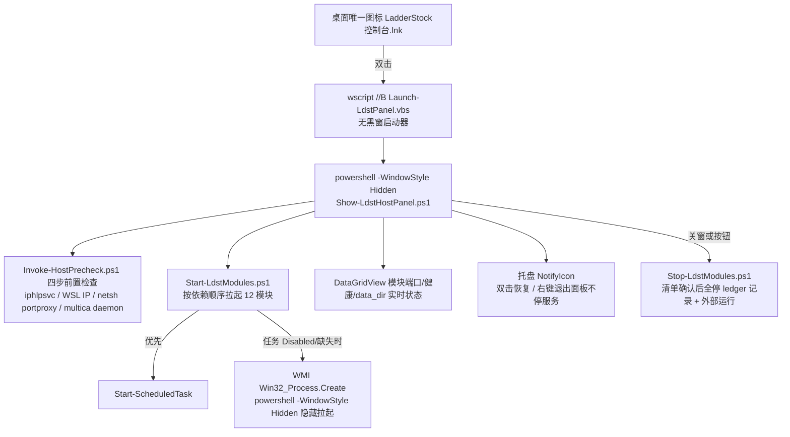

# LadderStock 宿主侧 supervisor 脚本（ops/host）

QUOT-483 交付：WSL 停服 + wsl.conf 修复、计划任务存活/死任务清单、桌面单图标入口、
Toast 通知（D5）、日志上限（D5）。全部脚本兼容 Windows PowerShell 5.1。

## 1. 单图标架构



## 2. 文件清单

| 文件 | 职责 |
| --- | --- |
| `LdstHostConfig.psd1` | 单一事实来源：模块表（任务/端口/健康探针/兜底命令）、StartOrder、KeepTasks、DeadTasks、日志上限、portproxy |
| `HostCommon.ps1` | 共享函数：配置/日志/端口探测/WSL 发行版探测/Toast/日志轮转/ledger/模块状态（**被 dot-source，不独立执行**） |
| `Invoke-HostPrecheck.ps1` | 四步前置检查（见下） |
| `Start-LdstModules.ps1` | 按依赖顺序拉起模块（任务通道优先、WMI 隐藏兜底），写 ledger |
| `Stop-LdstModules.ps1` | 停止（默认只停 ledger 中自己拉起的；`-All` 含外部运行），`-DryRun` 出清单 |
| `Show-LdstHostPanel.ps1` | 单图标面板：状态表 + 托盘 + 关窗清单确认（Yes=全停 / No=只关面板）；UI 线程未捕获异常兜底（写 `launcher\panel-error.log`，不弹 .NET 异常框） |
| `Launch-LdstPanel.vbs` | wscript 无黑窗启动器（面板批量预取优化配套：桌面入口走它彻底不闪控制台） |
| `New-DesktopShortcut.ps1` | 创建/更新桌面唯一图标；扫描并存旧入口清单（只报告不移除） |
| `Disable-DeadScheduledTasks.ps1` | 死任务禁用脚本——**默认干跑，禁用动作整体推迟，等 supervisor 验收通过后再启用** |
| `Restore-ScheduledTasks.ps1` | 应急回滚：把 Disabled 任务恢复启用（干跑 / `-Apply`） |
| `adapters/Repair-WslHost.ps1` | `/etc/wsl.conf` + `/usr/local/bin/wsl-boot.sh` 幂等校验/安装（Check / Install） |
| `adapters/Stop-WslServices.ps1` | WSL 内 FinanceCoffer 优雅停（compose stop → stop → kill + 回读确认）；`-IncludeWslShutdown` 显式关 VM |
| `adapters/Start-TickHubPeer.ps1` | 旧资产「启动_TickHub.cmd」→ TickHub CN（8000）起 |
| `adapters/Stop-TickHubPeer.ps1` | 旧资产「停止_TickHub.cmd」→ TickHub CN 停（含外部运行实例） |
| `adapters/Start-LadderStockBoard.ps1` | 旧资产「启动_LadderStock.cmd」→ LadderStock API + Schedule 起（无黑窗、data_dir 校验） |
| `adapters/Stop-LadderStockBoard.ps1` | 旧资产「停止_LadderStock.cmd」→ LadderStock API + Schedule 停 |

## 3. 部署

```powershell
# 把本目录整树复制到部署树（幂等覆盖）
robocopy <repo>\ops\host D:\QuotaFuseModules\LadderStock\ops\host /MIR
# 建桌面唯一图标（先确认 ops\host\Show-LdstHostPanel.ps1 已部署）
powershell -NoProfile -ExecutionPolicy Bypass -File D:\QuotaFuseModules\LadderStock\ops\host\New-DesktopShortcut.ps1
```

## 4. 日常使用

- **双击桌面 LadderStock 图标**：Hidden 窗口无黑窗 → 面板先跑四步前置检查 → 按依赖顺序拉起全部模块 → 图标缩到托盘；后续启动/失败结果以 Toast 通知（D5）。
- **面板**：表格实时显示每个模块的 计划任务状态 / 端口 / PID / 健康 / data_dir 校验结果；行底色：绿=正常、黄=端口不通、红=不健康（含 data_dir 不符）。
- **关闭面板窗口**：弹停止清单（与真实停止同一 `-DryRun` 代码路径）；选"是"全停，选"仅关面板"只收窗口（服务继续跑、托盘可再唤起）。托盘右键"退出面板（不停服务）"同理。

### 四步前置检查（Invoke-HostPrecheck）

1. `iphlpsvc` 服务非 Running → 尝试拉起（需管理员权限）；
2. `wsl -e bash -lc "hostname -I"` 取 WSL 发行版 IP（默认发行版动态探测，不写死 Ubuntu-24.04）；
3. `netsh portproxy` 重建 18080→8080 / 13000→3000 / 3000→3000 / 8080→8080（需管理员；既删既建，幂等）；
4. `multica daemon status` 未运行则 `daemon start --foreground` 并轮询等待 running（starting 是中间态，最长 60s）。

## 5. 停止安全模型

- **ledger**（`%LOCALAPPDATA%\LadderStock\logs\host-launcher.ledger.jsonl`）记账"本次谁拉起了什么"；
  `Stop-LdstModules` 默认只停 ledger 中自己拉起的模块，`-All` 才含外部运行实例。
- 杀进程前校验端口归属（持端口者才停）；任务通道用 `Stop-ScheduledTask`；永不触碰 multica daemon 进程本身。
- `-DryRun` 输出的清单与真实停止走同一 plan 生成代码，弹窗所见即所停。

## 6. 计划任务裁定（QUOT-483，2026-11-09 实测口径）

> 采集方法：`Get-ScheduledTask | Where TaskPath -notlike '\Microsoft\*'` 全量只读 + Action
> 路径存在性 + 端口归属进程树（证据：交付评论附件 test14-task-audit.txt / test14b-port-ownership.txt）。
> **本方案只入库不执行**：本轮交付不含任何已执行的 Disable / Enable 动作；下表 State 全为
> 现场实测原状。禁用动作整体推迟，等 supervisor 验收通过后由 482 调用（见脚本头注释）。

### 6.1 三类判定（与实测表逐条对应）

| 类 | 任务 | 实测 State | 判定 |
| --- | --- | --- | --- |
| A 保护 | Peer Startup Check | Ready | 保留。QUOT-401 自检：清单任务 Ready→拉起、Disabled→SKIP、只读不杀。现清单 5 条旧入口全 Disabled → 日志实证每次全 SKIP（无害空转）。收编候选：待 482 验收后把默认 `$Tasks` 换成 QF-Peer-* 六条 + TickHub CN 8000 |
| A 保护 | TickHub CN 8000 Watchdog | Ready | 保留。`serve-peer.ps1 -Action ensure`：自愈专用，永不杀外部持有者、永不抢端口；QUOT-456 §6.1 真实故障（result=0 但端口空）后的修复版 |
| A 保护 | LadderStock Modules | Ready | 保留。`start_all.cmd` 幂等批量兜底：端口 LISTENING 则 skip，否则 WMI 隐藏拉起；与 QF-Peer-* 调同一批 peers 脚本、同一判据，不双实例 |
| A 保护 | TickHub CN 8000 | Running | 保留。8000 唯一拉起路径（进程树：th-cn.exe start-all --port 8000 ← serve-peer.ps1 run） |
| B 真死 | LadderStock UI 5950 | Disabled | 与 LadderStock API 任务同体（同 Action 同端口 5950），双实例风险，维持 Disabled；5950 由 LadderStock API 单实例在供 |
| B 待裁定 | LadderStock Watchdog | Running | 暂保留。豆包沙箱 python 脆点（sandbox_runtime\bases 动态目录）；2026-11-09 实测 5952 进程树唯一守护（pid 3112 ← svchost Schedule）。可禁，但须等 482 自愈就位后执行 |
| B 待裁定 | LadderStock Watch Scan | Ready | 新发现：Action 指向已删 quot-200 run-logs\watch-scan.ps1（实测 MISSING），周期触发空失败。收编或退役由 supervisor 裁定，本轮不动 |

### 6.2 旧入口 6 条（Disabled 现状正确；端口由谁在供——进程树实证）

| 旧任务（Disabled） | Action 现状 | 端口现供者（实测） |
| --- | --- | --- |
| QF Wire 8790 | quot-200 run-logs 脚本 MISSING | QF-Peer-Wire-Web → `qfw.exe serve --port 8790` |
| QF Wire MCP 8791 | quot-200 脚本 MISSING | QF-Peer-Wire-MCP → `qfw.exe mcp http --port 8791` |
| StockSenate MCP 8765 | quot-200 脚本 MISSING | QF-Peer-StockSenate-MCP → `ssenate.exe mcp http --port 8765` |
| StockSenate WebUI 8788 | quot-200 脚本 MISSING | StockSenate WebUI 实际在 **8786**（`start_stocksenate_webui.cmd` 注释明示 8788 belongs to ProxyFleet/DEC-047）；8788 现由 ProxyFleet（`pfctl.py run`）持有。任务名「8788」为历史命名 |
| TickHub CN Admin 8787 | quot-200 脚本 MISSING | QF-Peer-TickHub-Admin → `th-cn.exe admin serve --port 8787` |
| TickHub US 8002 | quot-200 脚本 MISSING | QF-Peer-TickHub-US → `th-us.exe mcp http --port 8002` |

### 6.3 动作与脚本（可被 482 调用；默认干跑）

- **Disable**：`Disable-DeadScheduledTasks.ps1`（默认干跑只报告；`-Apply` 才禁用），清单 =
  `LdstHostConfig.psd1` 的 `DeadTasks` 7 条（上面 6 条旧入口 + LadderStock UI 5950）。
- **Restore**：`Restore-ScheduledTasks.ps1`（干跑 / `-Apply` Enable 回滚），与 Disable 同清单同口径；
  执行过的任务 XML 备份在 `%LOCALAPPDATA%\LadderStock\task-backups\`。
- **保护**：两脚本都跳过 `KeepTasks`（6.1 A 类 + Watchdog / Watch Scan 两条待裁定）。
- 实测基线（2026-11-09）：家族 Disabled 7 条（6 旧入口 + UI 5950），另有 1 条系统任务
  S-1-5-21-…（AgentActivationRuntimeStarter，无关）；QF-Peer-* 六条全 Running（开机 02:55:55 拉起，
  端口全部 LISTEN）——服务面未塌。

## 7. WSL（D1）

- `adapters/Repair-WslHost.ps1`：Check 默认只校验；Install 幂等写入 `/etc/wsl.conf`（systemd=false + boot command）与 `/usr/local/bin/wsl-boot.sh`（等 dockerd → compose up / docker start → 探 8100），写入前 `.bak-YYYYMMDD` 备份。
- `adapters/Stop-WslServices.ps1`：FC 停服=优雅优先逐层兜底，回读判据"docker ps 回读不到 financecoffer 容器"。
- **`wsl --shutdown` 风险**：会中断 WSL 内**全部**服务十几秒（VM 重启）。只有显式 `-IncludeWslShutdown` 才执行，执行前有 Toast + 日志警告；请避开盘中时段。WSL 下次启动时 wsl-boot.sh 自动拉回 FC。

## 8. 日志与上限（D5）

- 目录：`%LOCALAPPDATA%\LadderStock\logs\`（`host-*.log`、`host-launcher.ledger.jsonl`、`schedule-alerts.log`）。
- 上限：单文件超过 10MB 滚动为 `.1/.2/.3`，保留 3 份（`Invoke-HostLogRollover`，启动/停止/检查流程结尾统一触发）。

## 9. QUOT-482 依赖项说明（2026-11-09 核对）

- **482 supervisor 现状：未随本次更新，当前调不到死任务动作。**
  部署树 `D:\QuotaFuseModules\LadderStock\ops\schedule_supervisor.py` mtime 停在
  **2026-11-04 00:48**（QUOT-350 交付版）。实测其职责 = LadderStock Schedule（5952）调度守护
  （`ldst schedule run` 常驻重启 / 日志轮转 / 心跳 / 告警），全文无 `ops\host`、
  `Disable-DeadScheduledTasks`、`Restore-ScheduledTasks` 任何引用——**死任务动作的执行入口
  当前不存在于 supervisor【待 482】**。
- **占位约定（482 接入时按此调用；两条脚本默认干跑，误调零副作用）**：

  ```powershell
  # 禁用死任务（-Apply 才真禁；不带 -Apply 只报告）
  powershell -NoProfile -ExecutionPolicy Bypass -File D:\QuotaFuseModules\LadderStock\ops\host\Disable-DeadScheduledTasks.ps1 -Apply
  # 应急恢复（-Apply 才真恢复；干跑列出全部 DeadTasks 的 State 与可恢复性）
  powershell -NoProfile -ExecutionPolicy Bypass -File D:\QuotaFuseModules\LadderStock\ops\host\Restore-ScheduledTasks.ps1 -Apply
  ```

- **交接边界**：本轮交付 = 可被 482 调用的动作 + 脚本（默认干跑）+ 实测清单；不含任何已执行的
  Disable / Enable。禁用动作何时由 482 执行（含 LadderStock Watchdog 裁定、重启验收）由 482
  验收流程裁定。
