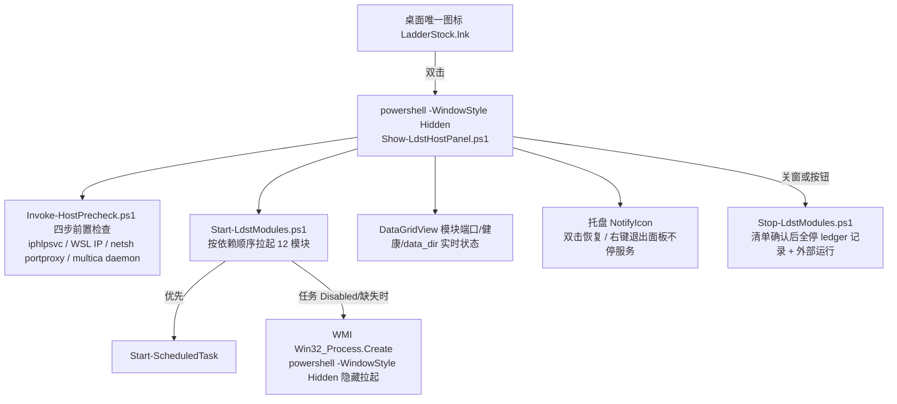

# LadderStock 宿主侧 supervisor 脚本（ops/host）

QUOT-483 交付：WSL 停服 + wsl.conf 修复、计划任务存活/死任务清单、桌面单图标入口、
Toast 通知（D5）、日志上限（D5）。全部脚本兼容 Windows PowerShell 5.1。

## 1. 单图标架构



## 2. 文件清单

| 文件 | 职责 |
| --- | --- |
| `LdstHostConfig.psd1` | 单一事实来源：模块表（任务/端口/健康探针/兜底命令）、StartOrder、KeepTasks、DeadTasks、日志上限、portproxy |
| `HostCommon.ps1` | 共享函数：配置/日志/端口探测/WSL 发行版探测/Toast/日志轮转/ledger/模块状态（**被 dot-source，不独立执行**） |
| `Invoke-HostPrecheck.ps1` | 四步前置检查（见下） |
| `Start-LdstModules.ps1` | 按依赖顺序拉起模块（任务通道优先、WMI 隐藏兜底），写 ledger |
| `Stop-LdstModules.ps1` | 停止（默认只停 ledger 中自己拉起的；`-All` 含外部运行），`-DryRun` 出清单 |
| `Show-LdstHostPanel.ps1` | 单图标面板：状态表 + 托盘 + 关窗清单确认（Yes=全停 / No=只关面板） |
| `New-DesktopShortcut.ps1` | 创建/更新桌面唯一图标；扫描并存旧入口清单（只报告不移除） |
| `Disable-DeadScheduledTasks.ps1` | 死任务禁用脚本——**默认干跑，禁用动作整体推迟，等 supervisor 验收通过后再启用** |
| `Restore-ScheduledTasks.ps1` | 应急回滚：把 Disabled 任务恢复启用（干跑 / `-Apply`） |
| `adapters/Repair-WslHost.ps1` | `/etc/wsl.conf` + `/usr/local/bin/wsl-boot.sh` 幂等校验/安装（Check / Install） |
| `adapters/Stop-WslServices.ps1` | WSL 内 FinanceCoffer 优雅停（compose stop → stop → kill + 回读确认）；`-IncludeWslShutdown` 显式关 VM |
| `adapters/Start-TickHubPeer.ps1` | 旧资产「启动_TickHub.cmd」→ TickHub CN（8000）起 |
| `adapters/Stop-TickHubPeer.ps1` | 旧资产「停止_TickHub.cmd」→ TickHub CN 停（含外部运行实例） |
| `adapters/Start-LadderStockBoard.ps1` | 旧资产「启动_LadderStock.cmd」→ LadderStock API + Schedule 起（无黑窗、data_dir 校验） |
| `adapters/Stop-LadderStockBoard.ps1` | 旧资产「停止_LadderStock.cmd」→ LadderStock API + Schedule 停 |

## 3. 部署

```powershell
# 把本目录整树复制到部署树（幂等覆盖）
robocopy <repo>\ops\host D:\QuotaFuseModules\LadderStock\ops\host /MIR
# 建桌面唯一图标（先确认 ops\host\Show-LdstHostPanel.ps1 已部署）
powershell -NoProfile -ExecutionPolicy Bypass -File D:\QuotaFuseModules\LadderStock\ops\host\New-DesktopShortcut.ps1
```

## 4. 日常使用

- **双击桌面 LadderStock 图标**：Hidden 窗口无黑窗 → 面板先跑四步前置检查 → 按依赖顺序拉起全部模块 → 图标缩到托盘；后续启动/失败结果以 Toast 通知（D5）。
- **面板**：表格实时显示每个模块的 计划任务状态 / 端口 / PID / 健康 / data_dir 校验结果；行底色：绿=正常、黄=端口不通、红=不健康（含 data_dir 不符）。
- **关闭面板窗口**：弹停止清单（与真实停止同一 `-DryRun` 代码路径）；选"是"全停，选"仅关面板"只收窗口（服务继续跑、托盘可再唤起）。托盘右键"退出面板（不停服务）"同理。

### 四步前置检查（Invoke-HostPrecheck）

1. `iphlpsvc` 服务非 Running → 尝试拉起（需管理员权限）；
2. `wsl -e bash -lc "hostname -I"` 取 WSL 发行版 IP（默认发行版动态探测，不写死 Ubuntu-24.04）；
3. `netsh portproxy` 重建 18080→8080 / 13000→3000 / 3000→3000 / 8080→8080（需管理员；既删既建，幂等）；
4. `multica daemon status` 未运行则 `daemon start --foreground` 并轮询等待 running（starting 是中间态，最长 60s）。

## 5. 停止安全模型

- **ledger**（`%LOCALAPPDATA%\LadderStock\logs\host-launcher.ledger.jsonl`）记账"本次谁拉起了什么"；
  `Stop-LdstModules` 默认只停 ledger 中自己拉起的模块，`-All` 才含外部运行实例。
- 杀进程前校验端口归属（持端口者才停）；任务通道用 `Stop-ScheduledTask`；永不触碰 multica daemon 进程本身。
- `-DryRun` 输出的清单与真实停止走同一 plan 生成代码，弹窗所见即所停。

## 6. 计划任务裁定（QUOT-483）

- **保留（KeepTasks，禁止禁用）**：Peer Startup Check、TickHub CN 8000 Watchdog、LadderStock Modules、LadderStock Watchdog、LadderStock Watch Scan。
- **可禁（DeadTasks）**：QF Wire 8790、QF Wire MCP 8791、TickHub CN Admin 8787、TickHub US 8002、LadderStock UI 5950。2026-11-08 只读探测：5 条现状均已是 Disabled。
  **本方案只入库不执行**：禁用动作按裁定整体推迟，等 supervisor 验收通过后再启用（见脚本头注释）。
- **恢复**：`Restore-ScheduledTasks.ps1 -Apply`（Enable 回滚）；Disable 执行过的任务，XML 定义备份在 `%LOCALAPPDATA%\LadderStock\task-backups\`。

## 7. WSL（D1）

- `adapters/Repair-WslHost.ps1`：Check 默认只校验；Install 幂等写入 `/etc/wsl.conf`（systemd=false + boot command）与 `/usr/local/bin/wsl-boot.sh`（等 dockerd → compose up / docker start → 探 8100），写入前 `.bak-YYYYMMDD` 备份。
- `adapters/Stop-WslServices.ps1`：FC 停服=优雅优先逐层兜底，回读判据"docker ps 回读不到 financecoffer 容器"。
- **`wsl --shutdown` 风险**：会中断 WSL 内**全部**服务十几秒（VM 重启）。只有显式 `-IncludeWslShutdown` 才执行，执行前有 Toast + 日志警告；请避开盘中时段。WSL 下次启动时 wsl-boot.sh 自动拉回 FC。

## 8. 日志与上限（D5）

- 目录：`%LOCALAPPDATA%\LadderStock\logs\`（`host-*.log`、`host-launcher.ledger.jsonl`、`schedule-alerts.log`）。
- 上限：单文件超过 10MB 滚动为 `.1/.2/.3`，保留 3 份（`Invoke-HostLogRollover`，启动/停止/检查流程结尾统一触发）。
